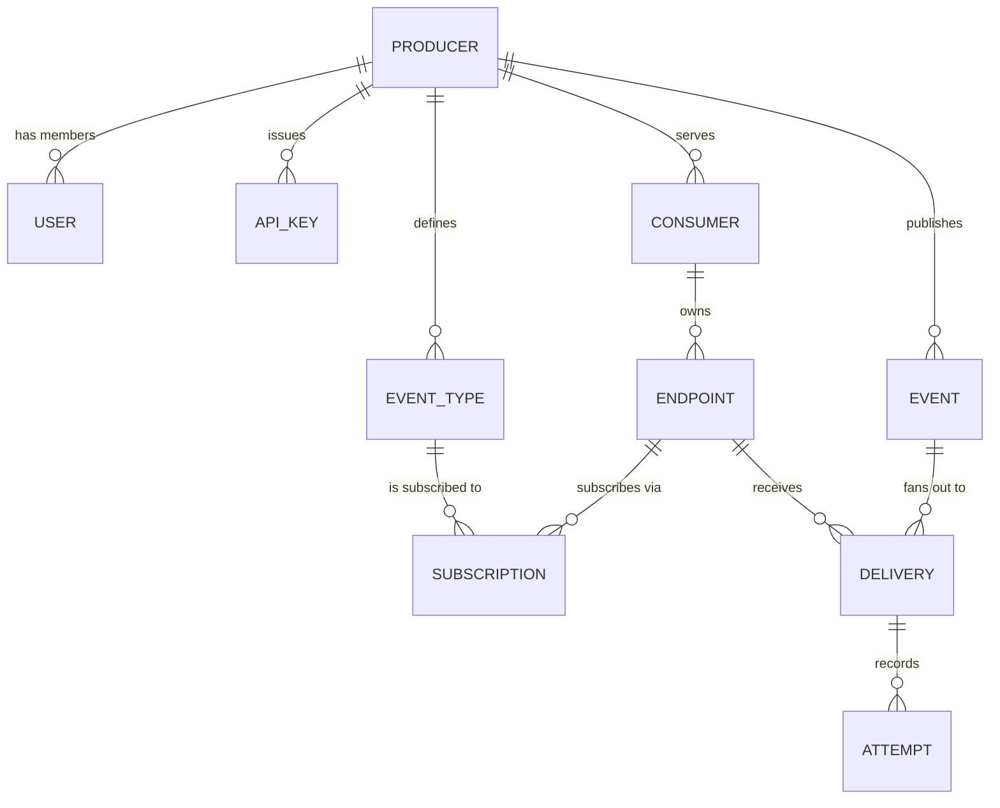

# Pigeon — Requirements (self-hosted, open source)

| | |
|---|---|
| **Version** | 1.0 — supersedes the 0.1 SaaS draft |
| **Status** | Design settled; decisions and open questions in §20 |
| **Scope** | v1.0 build spec, not a throwaway prototype |
| **Deployment target** | A single modest VPS, Docker Compose, no managed services |
| **Normative language** | MUST / SHOULD / MAY per RFC 2119 |

> **Why this supersedes 0.1.** The first draft specified a multi-tenant SaaS POC on managed infrastructure (SQS, Lambda, DynamoDB). The product is a self-hosted, open-source event delivery service. That inverts the infrastructure choices while leaving every **contract** intact — event envelope, signature, retry semantics, attempt trail, failure thresholds and absence alerting are unchanged. What changed is what sits underneath them.

---

## 0. North star: the production design, and where it inverts

The reference architecture is the six-stage design from the production system: **transactional outbox → event bus → fan-out → per-partner throttled queues → delivery with idempotency → dashboard and absence observability**. It is the north star because each stage encodes a failure mode that was paid for in production.

### 0.1 Stage mapping

Four stages change shape when the platform is self-hosted on one cheap machine. Two are genuine inversions - compute and transport - and two are substitutions that preserve the same contract:

| Stage | Cloud design | Self-hosted inversion | Why |
|---|---|---|---|
| Transport | Managed Kafka / Kinesis | **Redis Streams** | Same primitives — durable append, consumer group, ack, redelivery counter — at ~1 GB less RSS and no JVM. Kafka is the right answer at 1M events/day across many nodes; it is not the right answer in 4 GB. |
| Compute | Lambda + per-request pricing | **Fixed worker pool with elastic concurrency** | Serverless is cheaper when load is spiky *and* you pay per invocation. On a VPS you pay for the box whether it idles or not, so the optimisation target is *throughput per core*, not cost per invocation. Goroutines, not functions. |
| Fan-out isolation | Per-partner SQS queue | **Per-endpoint leased slots + token bucket in Redis** | The requirement is isolation, not queue count. A leased slot bounds in-flight concurrency and a bucket bounds rate; both live in Redis so they hold across replicas (FR-1302, FR-1306). |
| Recovery | Managed DLQ + autoscaling | **Dead-letter stream + operator runbook** | Same signal (per-endpoint failure depth), one fewer managed service. |

This note exists so the trade-offs are visible rather than accidental: **the design is the production design, re-hosted** — not a reduced one. Where a stage is deferred, §17 says so and says what it would take.

### 0.4 Prior art: Svix and Hook0

Two mature projects already do this, and the specification is only defensible if it is honest about them.

| | Svix (open source) | Hook0 | Pigeon v1.0 |
|---|---|---|---|
| Licence | MIT | SSPL-1.0 (source-available, blocks managed resale) | Apache-2.0 |
| Language | Rust (axum, sea-orm) | Rust | Go (§8.3) |
| Store | Postgres + pluggable queue (Redis or RabbitMQ) | Postgres | Postgres + Redis Streams |
| Deploy | Docker, Compose | Compose, Kubernetes | Compose, three deployables (core + producer portal + consumer portal) |
| Signature | Standard Webhooks (they authored the spec) | HMAC-SHA256 | **Standard Webhooks** (`webhook-id` / `webhook-timestamp` / `webhook-signature`) |
| Default retry window | Exponential over hours to days | Two-phase, backoff over days; 24 attempts, 8 d | 15 retries, exponential over 72 h, 12 h cap |
| SDKs | 8 languages, generated from OpenAPI | Rust client; SDKs MIT | None until v1.2 |
| Consumer portal | Hosted app portal, embeddable | Drop-in consumer portal | **v1.0**, self-hostable and brandable |
| Absence alerting | Not a published feature | Not a published feature | OBS-3, first-class |
| Retention | Policy-based | Policy-based | Disk-budget partition drop (§8) |

**They are ahead on features, and the gap is not close.** SDK breadth is what Pigeon defers to v1.2. Multi-day retries were in that category too and no longer are (§9), and the consumer portal is no longer deferred either: v1.0 ships two self-hostable portals (§14), which is where both vendors are weakest in their open-source editions - Svix's OSS build has no frontend at all, and Hook0's portal theming stops at a logo. Anyone who needs webhooks this month should still run Svix's open-source server rather than build this.

**Published pricing** (as listed on their sites at time of writing; verify before relying on it):

| | Svix | Hook0 | Pigeon |
|---|---|---|---|
| Free | $0 — 50k messages/mo | €0 — 100 events/day, extras blocked (429) | self-host, unlimited |
| Entry paid | $20/mo (Basic) | €59/mo (30k events/day) | — |
| Higher tier | $490/mo (Professional) | €190/mo (100k events/day) | — |
| Overage | $0.0001/message | €0.003 (Startup) / €0.0001 (Pro) per event | — |
| At ~1M deliveries/mo | ≈ $115 on Basic | ≈ €190 on Pro | ~$10-20 VPS + ops time |
| Metering unit | attempted message | event — fan-out and retries free | n/a |
| Self-host licence | MIT | SSPL-1.0 | Apache-2.0 |

**Two caveats on that table.** First, the metering unit is not the same thing: Hook0 bills per *event* and treats fan-out and retries as free, while Svix bills per *attempted message*, so ten subscriptions to one event cost ten messages on Svix and one event on Hook0. Any cost comparison at fan-out above 1 is materially affected and must be run against the real subscription count. Second, **neither vendor publishes a throughput benchmark**, and no independent one exists - their numbers are plan-level rate caps and marketing claims, while §8.1's numbers are a capacity model. A published, reproducible load test is therefore a genuine differentiator for this project, and it is cheap: §16 already specifies the test.

**Where the edge actually is.** Cost at volume (an order of magnitude below either), licence neutrality against SSPL, absence alerting, and behaviour on a disk small enough to matter. **Where it evaporates:** a self-hoster pays in operations what a customer pays in fees, and at Svix's $115/mo and Hook0's €190/mo tiers the arithmetic only favours self-hosting if an operator's time is cheap or the volume is past the overage threshold. Above roughly a million deliveries a month the monthly fee is the smaller number; below it, the pager is.

**Self-hosted throughput: neither publishes a benchmark.** What exists is three things, and none of them is a measurement:

1. **Hook0's single claim** - "a single node handles thousands of events per minute", without stating the machine, receiver latency, or subscription count. Thousands per minute is roughly 17-100 events/s depending on the word.
2. **The same sizing rule both use**, which Svix states explicitly: throughput = concurrency ÷ average receiver latency, and "with 300 ms average responses one worker sustains about three deliveries per second". This is exactly the model in §8.2, which is a point of agreement rather than a differentiator.
3. **Configuration defaults that let the number be derived.** Hook0's output worker exposes `CONCURRENT` (request attempts handled in parallel, default **1**), `MAX_DB_CONNECTIONS` (default 5, and the docs say it should equal `CONCURRENT` on the Postgres queue), `MAX_RETRIES` (**24**) and `MAX_RETRY_WINDOW` (**8 d**). So a default Hook0 worker at 300 ms latency delivers ~3.3/s; 100 deliveries/s needs ~30 concurrent slots, reached by raising `CONCURRENT` or adding worker replicas. Svix's equivalent concurrency is internal and not documented, so its self-hosted ceiling cannot be derived the same way.

One consequence for the throughput claims: **§8.1 is the only capacity figure in this comparison derived from a published row-level model**, which makes publishing its load test (§16) in both units - events/s and deliveries/s - the cheapest credibility available to the project. Hook0's retry defaults set the bar Q7 was resolved against: **24 attempts across 8 days**, against our 15 across 72 hours.

The defensible reasons to build it anyway are operational, not capability-based:

1. **Licence.** SSPL bars organisations with a no-SSPL policy from Hook0 outright; MIT and Apache-2.0 do not. That is a real adoption gate rather than a preference.
2. **Behaviour on a small host.** Neither project optimises for a 40 GB disk that must drop partitions before it fills, or for telling an operator what their sustained ceiling is (§8.1.1). Both assume you will give them reasonable infrastructure.
3. **Absence detection.** Both alert on failed deliveries. Neither publishes a first-class lower-bound alarm for events that should have been produced and were not - the exact gap that cost the production system a day (§18, OBS-3).
4. **Operational surface.** One `docker compose up` with a `doctor` command, and the portals shipped as first-class deployables rather than as a paid add-on. The honest trade is that three deployables is more moving parts than one binary - the reason to accept it is that a producer portal and a consumer portal have different audiences, different auth, and different release cadences, and fusing them is how the production system ended up with a portal nobody outside the company could use.

**Two consequences for this specification.** First, the retry window was the weakest part of it and is now resolved in the other direction: **15 retries on exponential backoff across 72 hours** (§9), which meets Hook0's multi-day default without matching its attempt count. A receiver down for an afternoon now recovers on its own instead of landing in the dead-letter queue, and the remaining trade - that a three-day window makes priority events stale - is handled per endpoint rather than globally. Second, the bespoke signature format buys nothing that the Standard Webhooks specification would not give free - verifier libraries, documented headers, and interoperability with anyone already implementing it (Q6).

---

## 1. Problem

Services that expose an API accumulate integrations that poll it. Polling is a pull system with no knowledge of when state changed: it cannot tell the caller that nothing new happened, it cannot be rate-limited into correctness, and its cost lands on the shared read path rather than the team generating it.

A webhook platform replaces the poll with a push, and in doing so takes on the hard parts the caller would otherwise implement badly:

- an event must be delivered **at least once**, which means retries, which means duplicates, which means the receiver must be idempotent;
- the receiver's endpoint is an untrusted, slow, frequently broken dependency that must not be allowed to damage anyone else;
- the sender must be able to prove what it sent, to whom, when, and what came back;
- and an event that was never generated must be **detectable**, because "we sent nothing" looks identical to "nothing happened".

Most teams that add webhooks implement the happy path in an afternoon and then spend two years discovering the rest. This platform is the rest.

---

## 2. Product definition

A self-hosted service that any team can run on a small VPS to send webhooks to **their** customers. One binary plus Postgres plus Redis. A producer publishes an event; every subscribed endpoint receives a signed HTTP POST; every attempt is recorded; anything that fails is inspectable, retryable, and replayable by the sender without a support ticket.

It is explicitly **not** a SaaS and not a framework you embed in your application. It runs as its own process, owns its own datastore, and exposes an HTTP API — so it can be adopted by a team that does not want to link a library into a monolith.

### 2.1 What "modest machine" means

The reference deployment — and the machine every performance target in §12 is written against:

| Resource | Reference | Floor |
|---|---|---|
| CPU | 2 vCPU | 1 vCPU |
| RAM | 4 GB | 2 GB |
| Disk | 40 GB SSD | 20 GB |
| OS | Any Linux with Docker | — |
| Services | Core + producer portal + consumer portal + Postgres + Redis, five containers, co-located | Same |

Install is one `docker compose up` that brings up all five. No cloud account, no managed queue, no external object store. The portals are separate deployables from the core, not a UI compiled into it - they can be hosted on different hosts, put behind separate DNS names, or omitted entirely if a producer only ever uses the API.

### 2.2 Reference architecture

```
  producer backend
        │  POST /v1/events  (event + outbox, one transaction)
        ▼
  ┌──────────────┐        ┌──────────────┐        ┌────────────────┐
  │  Ingest API  │───────▶│   Postgres   │◀──────▶│  Producer      │
  └──────────────┘        │  events      │        │  portal        │
                          │  outbox      │        └────────────────┘
                          │  deliveries  │◀──────▶┌────────────────┐
                          │  attempts    │        │  Consumer      │
                          └──────┬───────┘        │  portal        │
                 relay (SKIP LOCKED, LISTEN/NOTIFY + 1 s poll)      │
                                 ▼               └────────────────┘
                          ┌──────────────┐              ▲
                          │ Redis Streams│              │ session token
                          │ events       │              │ (same API)
                          │ deliveries:* │──────────────┘
                          │ dlq · limits │
                          └──────┬───────┘
                                 ▼
                    ┌─────────────────────────┐
                    │  Delivery workers       │
                    │  leased endpoint slots  │
                    │  sign → POST → attempt  │
                    └───────────┬─────────────┘
                                ▼
                     consumer endpoints (HTTPS)
```

Both portals are clients of the same API, not privileged back doors. That is what keeps three deployables from becoming three codebases.

**Component responsibilities**

| Process | Owns | Must not |
|---|---|---|
| Ingest API | validate, write event + outbox atomically, return `202` | perform delivery work |
| Relay | move outbox rows to the events stream | know about subscriptions |
| Fan-out consumer | resolve subscriptions, create delivery rows, enqueue tasks | call consumer endpoints |
| Delivery worker | sign, POST, record attempt, apply retry policy | create deliveries or resolve subscriptions |
| Sweeper | re-claim expired leases, drop partitions — **single leaseholder** (D-7) | run concurrently with itself |
| Flusher | drain the attempt buffer into Postgres in batches | interpret attempts |
| Read API | serve deliveries, attempts, replay | — |
| Producer portal | configuration and fleet-wide visibility | embed business logic |
| Consumer portal | one consumer's self-service surface | see any other consumer |

**Stack**

| Concern | Choice | Note |
|---|---|---|
| Language | Go 1.23+ | §8.3 |
| Database | PostgreSQL 16, range-partitioned | `SKIP LOCKED` relay, JSONB payloads, one transaction for event + outbox |
| Queue | Redis 7 Streams | consumer groups, redelivery counter, leased slots, token buckets — one dependency |
| Portals | server-rendered Go templates + htmx, shared component library, `go:embed` assets | three images total; no Node toolchain for the operator |
| Migrations | embedded, applied on boot behind a Postgres advisory lock | never two migrators (OPS-9) |
| Metrics | Prometheus exposition; Grafana optional | §13 |
| Tracing | OpenTelemetry, OTLP, off by default | §13 |
| Packaging | three `scratch`-based images + one compose file | §15.2 |

### 2.3 What the first release proves

| # | Proposition | Proof |
|---|---|---|
| P1 | A developer can run it and receive a signed webhook in under 15 minutes | Timed walkthrough on a fresh VPS |
| P2 | Delivery is at-least-once and both sides can inspect every attempt | Attempt trail in UI and API |
| P3 | An accepted event cannot be lost, including across a Redis wipe | Fault injection (§16.5) |
| P4 | One slow endpoint cannot degrade another producer | Load test with a hanging endpoint |
| P5 | Absence of expected events is alertable, not just failures | Absence alarm drill |
| P6 | Throughput is credible for a small/medium service, not a demo | Committed load test at 1k events/s |

---

## 3. Goals and non-goals

### 3.1 Goals

- **G-1** One-command deployment on the reference machine, no external dependency beyond co-located Postgres and Redis.
- **G-2** An accepted event is never lost — across worker crash, relay crash, Redis wipe, or restart.
- **G-3** At-least-once delivery with an explicit guarantee, two dedupe keys, and a documented contract.
- **G-4** Per-endpoint isolation of concurrency, rate, retries, and failure, so a broken receiver damages only itself.
- **G-5** Complete, queryable evidence for every delivery attempt, visible to the sender and readable by the receiver's owner.
- **G-6** Self-service: subscribe, inspect, replay without opening a ticket.
- **G-7** Alerting on absence, not only on failure.
- **G-8** Throughput suited to a small or mid-sized business: ~100K events/day sustained, bursting to 1K events/s, on one modest host.

### 3.2 Non-goals

- Multi-region, HA failover, or an enterprise SLA.
- Nested org hierarchy beyond producer → consumer → endpoint.
- Event transformation, mapping, or workflow automation (we deliver bytes, we do not rewrite them).
- Inbound webhooks, i.e. receiving third-party callbacks. We are only ever the sender.
- A hosted control plane, billing, or usage-based pricing. It is free software; the operator meters nothing.
- SDKs in the first release (§17).

---

## 4. Actors and terminology

| Term | Definition |
|---|---|
| **Operator** | Whoever self-hosts the instance. Owns the box, config, upgrades. Not a product role. |
| **Instance admin** | Bootstrap credential created on first run; creates the first producer, can inspect a stuck instance. Audited, and not usable as a producer credential. |
| **Producer** | An isolated tenant inside one deployment. Isolation and quota boundary. |
| **User** | A human logging into a portal, belonging to a producer (or one consumer), with a role. |
| **Consumer** | The producer's own customer — owner of receiving endpoints. Grouping and permission boundary. |
| **Endpoint** | Destination URL + secret + headers + subscriptions. The unit of delivery. |
| **Event type** | A named contract (`resource.action`) with a JSON Schema and payload version. Producer-scoped. |
| **Event** | One occurrence published by a producer. |
| **Delivery** | The intent to send one event to one endpoint. Durable, independently tracked. |
| **Attempt** | One HTTP request made in service of a delivery. |
| **Lease** | A short-lived claim a worker holds on a delivery. The only authority on whether work is in flight. |

**A note on two overloaded words.** In this document a **producer** is a tenant organisation that emits events, and a **consumer** is one of that producer's customers receiving them. Neither is the Kafka meaning: where the infrastructure sense appears it is always written *consumer group* or *producer client*, never bare "consumer"/"producer". A producer is also not the same thing as the publisher code inside it - the producer is the isolation boundary, the publisher is the process calling `POST /v1/events`.

### 4.1 Role matrix

| Capability | Producer owner | Producer developer | Consumer user | Instance admin |
|---|---|---|---|---|
| Manage members | MUST | — | — | MUST |
| Issue/revoke API keys | MUST | SHOULD | — | — |
| Publish events | MUST | MUST | — | — |
| Manage **own consumer's** endpoints | MUST | MUST | **MUST** | — |
| Manage **own consumer's** subscriptions | MUST | MUST | **MUST** | — |
| Manage event types | MUST | SHOULD | — | — |
| View own consumer's deliveries | MUST | MUST | MUST | — |
| Trigger replay | MUST | SHOULD | **MUST** | — |
| Rotate own endpoint secret | MUST | MUST | MUST | — |
| Configure own notification email | MUST | SHOULD | MUST | — |
| View all producers | — | — | — | MUST |
| Upgrade / configure instance | — | — | — | MUST |

The consumer-user row is the reason the architecture has three deployables rather than one. A consumer user is not a junior producer member: they belong to exactly one consumer, see exactly that consumer's endpoints and deliveries, and can perform every routine operation on them without a producer member's involvement. Everything they do is row-filtered by `consumer_id`, not merely hidden in a UI.

---

## 5. Domain model



**Invariants**

- **I-1** Every entity except `producer` carries `producer_id`, and no query path exists that does not filter on it.
- **I-2** A `delivery` row is created before the first attempt and is not removed before its retention window. It is the durable record that this event was owed to this endpoint.
- **I-3** `(event_id, endpoint_id)` is unique for **first fan-out**, so fan-out is idempotent by construction. A replay is deliberately a second delivery for the same pair, linked by `replay_of_delivery_id` and made idempotent by its own request key (FR-1106, FR-1107); the uniqueness is a partial index over rows where `replay_of_delivery_id IS NULL`.
- **I-4** A delivery is terminal only in `delivered`, `failed_terminal`, `cancelled`. Everything else is in flight and MUST be visible as in-flight.
- **I-5** Event type names are unique per producer, not globally.
- **I-6** A delivery's lease is the only authority on whether it is being worked on. Status is never inferred from the attempt log.

---

## 6. Durability contract

"What do we lose?" must be a table, not a promise.

| What | Durable where | Worst-case loss | Consequence |
|---|---|---|---|
| Accepted event (`202` returned) | Postgres `events` + `outbox`, one transaction | none | — |
| Publish intent | Postgres `outbox` | none | — |
| Delivery record at fan-out | Postgres, batched insert | ≤ 200 ms; rebuildable by re-fan-out | none — the partial `(event_id, endpoint_id)` unique index over first fan-out makes re-fan-out idempotent (I-3) |
| Attempt record + response body | Redis Stream with a consumer group → Postgres batches, acked only after the commit | **0 on worker crash**; ≤ 1 s if Redis itself dies uncleanly | evidence gap only; the delivery is still driven by its lease, and the attempt counter by control state (D-2) |
| Terminal delivery state | Postgres, control batch (`synchronous_commit=on`) | none | — |
| Dedupe key `(endpoint, event_id)`, first 14 d | the `deliveries` row itself | none while the partition exists; under SB-3 disk pressure a partition dropped before its copy ran loses every key it held, logged at warn (FR-903) | a support answer is missing; never a delivery |
| Dedupe key, 14 to 30 d tail | Postgres `delivery_dedupe`, copied from a partition as the sweeper drops it (FR-905) | none on an ordinary drop - the copy and the drop commit in one transaction and a failed copy aborts both (FR-905); under SB-3 disk pressure either that partition's 14 to 30 d tail (dropped before its copy ran) or whole archived day-ranges (dropped oldest-first ahead of `dedupe_retention`), or both in one pressure event, each logged at warn with the partition and days (FR-903) | a support answer is missing; never a delivery |
| Signing secret, config | Postgres, synchronous | none | — |

**Rules**

- **D-1** The attempt buffer MUST live in Redis, never in worker process memory. A worker crash therefore loses nothing; only a Redis crash can lose the tail.
- **D-2** Retry and status MUST NOT depend on the attempt buffer. Retry is driven by `lease_expires_at`; the attempt counter is control state on the delivery row (`deliveries.attempts`), advanced monotonically by the write that schedules the retry and returned with the claim, and MUST NOT be derived from the buffer. An attempt carries `max(deliveries.attempts, the attempt rows already written) + 1`, so `buffered` and `sync` number attempts identically. The Redis Stream's pending-entry list is the buffer's own recovery accounting - it is what lets an un-acked evidence batch be reclaimed after a flusher crash - and is not the attempt counter. `attempt_log.mode = buffered | sync` MUST be configurable — `sync` writes every attempt inline, and has no stream to count entries in, for operators who value evidence over throughput.
- **D-3** On `SIGTERM`, workers MUST drain in-flight attempts and the flusher MUST flush before exit. Deploys and restarts lose nothing.
- **D-4** The relay MUST have both a `LISTEN/NOTIFY` fast path and a 1 s polling fallback: a notification is not durable, and a missed one must not strand an event.
- **D-5** Redis MUST run `appendonly yes` with `appendfsync everysec`; RDB-only persistence is unsupported because it loses the queue. The startup gate is OPS-7.
- **D-6** The sweeper MUST re-queue any delivery whose `lease_expires_at < now` within 10 s, so a crashed worker costs one lease interval, not a lost delivery.
- **D-7** Exactly one sweeper MUST be active per deployment. Leadership is taken with a Postgres advisory lock and MUST be released within 30 s of the holder dying, because partition drops (SB-3) are destructive and MUST NOT run concurrently. Every other core replica runs as a standby that competes for the lock.
- **D-8** Pause state for an endpoint or a subscription MUST be a durable Postgres column written as control state, never a Redis key. Losing a failure-counter window MAY delay a pause, but MUST NOT pause or unpause anything.

---

## 7. Functional requirements

Priorities: **P0** ships or nothing · **P1** in the first release, cuttable under time pressure · **P2** later.

### 7.1 Producer and identity (FR-1)

| ID | Requirement | Pri |
|---|---|---|
| FR-101 | First run MUST create one instance-admin credential, printed once to stdout, with a forced password change. | P0 |
| FR-102 | The instance admin MUST be able to create producers; self-registration MUST default off and be enableable by config. | P0 |
| FR-103 | A producer MUST support `test` and `live` environments with fully separated data and keys. | P0 |
| FR-104 | Owners MUST be able to invite users by email with role `owner` or `developer`. | P1 |
| FR-105 | A user MUST be able to belong to more than one producer. | P1 |
| FR-106 | Optional OIDC login MUST be configurable by env vars, with password auth remaining available. | P1 |
| FR-107 | Suspending a producer MUST stop ingestion and non-terminal deliveries, reversibly. | P1 |
| FR-108 | Producer-scoped resources MUST be reachable only via that producer's credential; violations MUST return `404`, never `403`. | P0 |
| FR-109 | Producer owners MUST be able to invite a **consumer user**, bound to exactly one consumer, and revoke that access independently of the consumer record. | P0 |
| FR-110 | A consumer user's credential MUST be bound to exactly one `consumer_id` at issuance, and every API request made with it MUST be filtered by that binding server-side, never by a field the client asserts. | P0 |
| FR-111 | Consumer users MUST authenticate by emailed invitation or password reset; they MUST NOT be able to self-register into a producer. | P0 |
| FR-112 | A portal session MUST be an opaque random token, stored only as a hash, delivered as an `HttpOnly; Secure; SameSite=Lax` cookie (FR-1009) and accepted by the API as a bearer; the scope binding MUST live in the session record, not in the token or the client. Revocation MUST take effect within 5 s. | P0 |
| FR-113 | The consumer portal MUST call the core API over the network as a scoped client, presenting that session's bearer, and MUST NOT authorise anything itself: a request the portal could make is a request the same token could make directly. The CSRF token on its own mutations is the browser-to-portal token of FR-1009 (§14.2), which the portal mints and verifies itself; it is not presented to the core, and no second token is minted for the portal-to-core hop. | P0 |

### 7.2 API keys (FR-2)

| ID | Requirement | Pri |
|---|---|---|
| FR-201 | Producers authenticate to the API with a bearer key. | P0 |
| FR-202 | Keys MUST be shown once and stored only as a hash. | P0 |
| FR-203 | A key MUST be scoped to one producer and one environment. | P0 |
| FR-204 | Multiple concurrent keys per producer MUST be allowed, so rotation needs no downtime. | P1 |
| FR-205 | Revocation MUST take effect within 60 s across all instances. | P0 |
| FR-206 | Each key MUST record `last_used_at`, surfaced in the UI. | P1 |
| FR-207 | Keys MUST be rate-limited per key and per producer; over-limit returns `429` with `Retry-After`. | P0 |
| FR-208 | Keys MUST support an optional `replay` scope, separating publish credentials from administrative ones. | P2 |

### 7.3 Event types (FR-3)

| ID | Requirement | Pri |
|---|---|---|
| FR-301 | A producer MUST define an event type with a name and a JSON Schema for its payload. | P0 |
| FR-302 | Names MUST match `^[a-z][a-z0-9_]*\.[a-z][a-z0-9_]*$` and be immutable after creation. | P0 |
| FR-303 | Publishing a payload that violates its schema MUST return `422` naming the failing JSON pointer. | P0 |
| FR-304 | An event type MUST carry `payload_version`; a new version MUST NOT change what is delivered to endpoints still on the old version. | P1 |
| FR-305 | An event type MUST be disableable without deleting history. | P1 |
| FR-306 | Three example event types MUST be seeded per new producer. | P1 |

### 7.4 Endpoints (FR-4)

| ID | Requirement | Pri |
|---|---|---|
| FR-401 | Register an endpoint with name, URL, owning consumer, and subscriptions. | P0 |
| FR-402 | URLs MUST be `https` in live mode; `http` in test only. Private, loopback, link-local, and metadata ranges MUST be rejected unless the endpoint is marked `internal`. | P0 |
| FR-403 | Ownership MUST be verified by a challenge before live delivery; unverified endpoints MUST NOT receive live events. | P0 |
| FR-404 | Each endpoint MUST have its own signing secret, rotatable with a 24 h overlap. | P0 |
| FR-405 | Up to 5 custom headers per endpoint; `Host`, `Content-Length`, `Content-Type`, `Authorization` MUST be rejected. | P1 |
| FR-406 | Endpoints MUST be pausable; a paused endpoint collects no new deliveries and holds in-flight ones without consuming retry budget. | P0 |
| FR-407 | Endpoint deletion MUST retain history for the retention window and MUST NOT orphan deliveries. | P0 |
| FR-408 | Each endpoint MUST expose a health summary: last success, failure streak, paused state, p95 latency. | P1 |

### 7.5 Subscriptions (FR-5)

| ID | Requirement | Pri |
|---|---|---|
| FR-501 | A subscription is the `(endpoint, event_type)` pair, independently creatable and deletable. | P0 |
| FR-502 | Fan-out MUST resolve an event to all active subscriptions with a matching type on an active endpoint. | P0 |
| FR-503 | An event with no matching subscription MUST create no deliveries and consume no retry budget; its reason code is defined in §7.5a. | P0 |
| FR-504 | Per-subscription filters (equality on top-level payload fields). | P2 |

### 7.5a Routing: which consumer an event belongs to

Two independent decisions produce a delivery, and neither party can make the other's:

| Decision | Made by | Expressed as |
|---|---|---|
| Who is this event about? | The producer, at emit time | `consumer_id` (ours) or `consumer_ref` (theirs), exactly one per event |
| Who wants it, and where? | The consumer, at configuration time | subscription `(endpoint, event_type)` |

Fan-out is the intersection. **A producer never names an endpoint or a URL.** If it did, a consumer could not add or move an endpoint without a code change on the producer's side, which is precisely the coupling the platform exists to remove. The producer supplies the one thing it already holds in context when the business event happens - its own customer identifier - and the platform resolves it.

Routing mode is declared on the event type and is immutable:

| Mode | Required input | Fan-out target |
|---|---|---|
| `consumer` | `consumer_id` or `consumer_ref` | Active subscriptions belonging to that consumer only |
| `broadcast` | none | Producer-level endpoints with no consumer attached (ops, BI, internal systems) |

`consumer_ref` is the producer's own identifier (a school id, a customer id, an account number) rather than our opaque `consumer_id`, so no mapping table has to be maintained on their side and re-registering a consumer does not break their code. It is therefore a routing key and must be treated as one: unique per producer, case-sensitive, immutable.

The failure that matters is the silent one. An event for a consumer nobody has onboarded yet must not vanish, and must not be indistinguishable from an event nobody subscribed to:

| Situation | Recorded as | Fix it implies |
|---|---|---|
| `consumer_ref` matches no consumer | `unroutable:consumer_not_registered` | Onboard the consumer, or fix the ref |
| Consumer exists, no endpoint subscribed to this type | `not_delivered:no_matching_subscription` | Consumer enables the subscription |
| Subscribed, endpoint unverified | `not_delivered:endpoint_unverified` | Consumer completes verification |
| Subscribed, endpoint or subscription paused | `not_delivered:endpoint_paused` | Consumer resumes or fixes the endpoint |

Each is a different email to a different person, which is why one generic `not_delivered` state is not enough.

| ID | Requirement | Pri |
|---|---|---|
| FR-505 | An event of a `consumer`-routed type MUST carry exactly one of `consumer_id` or `consumer_ref`; supplying both or neither MUST return `422` naming the conflict. | P0 |
| FR-506 | `consumer_ref` MUST be unique per producer, case-sensitive, and immutable once set; changing it MUST require an explicit re-key operation, because it is the routing key. | P0 |
| FR-507 | Fan-out MUST select endpoints as the active endpoints of the resolved consumer intersected with active subscriptions for the event type. | P0 |
| FR-508 | An event whose `consumer_ref` resolves to no consumer MUST still be accepted (`202`), recorded as `unroutable:consumer_not_registered`, and surfaced in the UI and a metric; it MUST NOT be silently discarded. In the `test` environment the same case MUST return `422`, so an integration bug surfaces before go-live. | P0 |
| FR-509 | Every non-delivery MUST carry a distinct reason from the table above, because each has a different remediation and a different owner. | P0 |
| FR-510 | One event MUST represent one business occurrence for one consumer. A batch affecting N consumers MUST be published as N events, so payload size stays bounded, dedupe stays per-consumer, and one consumer's failing endpoint cannot delay the other N-1. | P0 |
| FR-511 | `consumer_ref` resolution MUST be cached in Redis with invalidation on consumer change, so publish latency excludes the lookup. | P1 |
| FR-512 | An API key MAY be scoped to a single `consumer_ref`, for producer backends that emit from a per-consumer context. | P2 |
| FR-513 | The envelope of a `consumer`-routed event MUST carry the resolved `consumer_ref` whether the producer supplied `consumer_id` or `consumer_ref`; `consumer_id` MUST NOT appear in the envelope, and a `broadcast` event carries neither. | P0 |
| FR-514 | A `consumer_id` that is unknown, deleted, or belongs to another producer MUST be treated exactly as an unresolvable `consumer_ref` (FR-508), so the two reference forms cannot diverge and no id-enumeration oracle exists. | P0 |

### 7.6 Ingestion (FR-6)

| ID | Requirement | Pri |
|---|---|---|
| FR-601 | `POST /v1/events` MUST return `202` with an `event_id`. | P0 |
| FR-602 | `POST /v1/events/batch` MUST accept up to 500 events with per-item results. | P1 |
| FR-603 | Publish MUST be idempotent on a caller `Idempotency-Key` for 24 h, returning the original `event_id`. | P0 |
| FR-604 | The event row and outbox row MUST be written in one transaction; `202` MUST NOT be returned if either write fails. | P0 |
| FR-605 | `occurred_at` MUST be accepted within `[now − 7d, now + 5m]`. | P1 |
| FR-606 | Payloads over 64 KB MUST return `413`; over-quota publishes MUST return `429`. | P0 |
| FR-607 | Publish MUST resolve the consumer before accepting the event, and MUST fail closed when the event type is `consumer`-routed and the reference is missing (§7.5a). | P0 |

### 7.7 Fan-out (FR-7)

| ID | Requirement | Pri |
|---|---|---|
| FR-701 | The relay MUST publish outbox rows to the events stream, marking published only after the broker acknowledges. | P0 |
| FR-702 | Rows MUST be claimed with a lease (`SKIP LOCKED`) so two relays never publish the same row. | P0 |
| FR-703 | Fan-out MUST create one delivery per matching subscription before any attempt, one transaction per event. | P0 |
| FR-704 | Fan-out MUST be idempotent on `(event_id, endpoint_id)`. | P0 |
| FR-705 | Priority and normal events MUST use separate streams and separate worker pools. | P0 |
| FR-706 | Delivery-row creation MUST be batched (multi-row insert), never one round-trip per row. | P0 |

### 7.7a Event classes

| Class | Examples | Latency target | Queue |
|---|---|---|---|
| Priority | `payment.succeeded`, mandate set up, anything unblocking a user flow | p99 ≤ 2 s | `deliveries:priority` |
| Normal | settlement, reconciliation, master-data changes | same day; p99 ≤ 60 s | `deliveries:normal` |

The class is declared on the event type, not chosen per event, so a payload cannot silently change its own urgency.

### 7.8 Delivery (FR-8)

| ID | Requirement | Pri |
|---|---|---|
| FR-801 | Delivery MUST POST the signed envelope with configured headers and `Content-Type: application/json`. | P0 |
| FR-802 | Each attempt MUST time out at **5 s**, configurable per endpoint within `[2s, 5s]`. 5 s is a hard ceiling, not a default: a receiver that cannot acknowledge inside it is treated as unavailable. | P0 |
| FR-803 | `delivered` only on `2xx`; redirects MUST NOT be followed. | P0 |
| FR-804 | Status code and first 2 KB of body MUST be persisted per attempt. | P0 |
| FR-805 | Retry MUST occur on timeout, connection/DNS error, `408`, `425`, `429`, `5xx`. | P0 |
| FR-806 | `400`, `401`, `403`, `404`, `410`, `422` MUST fail terminal immediately. | P0 |
| FR-807 | `Retry-After` on `429`/`503` ≤ 300 s MUST override computed backoff. | P1 |
| FR-808 | Delivery MUST honour per-endpoint concurrency and RPS caps (§7.13). | P0 |
| FR-809 | An expired lease MUST make a delivery claimable again, so work held by a crashed worker is retried (D-6). | P0 |
| FR-810 | `User-Agent` MUST identify the platform and version, overridable per endpoint. | P1 |
| FR-811 | An attempt row MUST be written only for a failed attempt or a retried delivery. A successful first attempt MUST be recorded as columns on the delivery row (`status`, `attempts`, `first_attempt_at`, `delivered_at`), not as a separate row. | P0 |
| FR-812 | Evidence writes MUST use `synchronous_commit=off`; control-state writes (event, outbox, delivery row, terminal status) MUST use `synchronous_commit=on`. The split is the durability contract in §6 expressed as a connection setting. | P0 |
| FR-813 | The lease MUST be set when the delivery row is created at fan-out, never at claim time; a worker MUST write only on completion or terminal failure. | P0 |
| FR-814 | Hot tables (`deliveries`, `attempts`) MUST carry no more than three indexes each, and every index MUST map to a query the UI or API actually issues. | P0 |
| FR-815 | All inserts MUST be batched - at least 2,000 rows per transaction at the reference load - so commit rate stays in the tens per second rather than the thousands. | P0 |

### 7.9 Idempotency (FR-9)

| ID | Requirement | Pri |
|---|---|---|
| FR-901 | Every event MUST carry a globally unique `event_id` (ULID). | P0 |
| FR-902 | The envelope MUST carry `delivery_id`, distinct from `event_id`, plus `attempt`. | P1 |
| FR-903 | Support MUST be able to answer "was this event a duplicate for this endpoint?" for 30 days after delivery, and the answer MUST survive a Redis wipe and outlive delivery retention. Exactly two kinds of SB-3 disk-pressure drop MAY shorten that window, each logged at warn with the partition and the day range it covered, so the gap is known rather than discovered (one pressure event can produce both): a `deliveries` partition dropped before its copy ran, which loses the answer for every key that partition held from the moment of the drop - SB-3 drops on disk pressure *before* age, so the partition can still be inside its first 14 days and the loss is not confined to the 14 to 30 d portion; and a `delivery_dedupe` partition dropped before its `dedupe_retention`, so the archive's oldest days disappear whole (FR-905). No other drop and no other failure MAY lose a dedupe answer: an age-driven drop in particular loses nothing, because FR-905 requires the copy and the drop in one transaction and aborts that transaction if the copy fails. | P1 |
| FR-904 | The integration guide MUST state the idempotency requirement and name both keys. | P0 |
| FR-905 | The dedupe answer MUST be served from Postgres: from the `deliveries` row while its partition exists, and otherwise from a range-partitioned archive table copied at partition drop, with configurable archive retention (default 30 d, so the archive holds only the difference between the two retentions). Nothing about dedupe MAY live in Redis, and the archive MUST be dropped by partition, never by `DELETE`. An ordinary drop MUST copy the partition and drop it **in one transaction**, so that at every instant either the `deliveries` row or the archive row answers a key (both commit or neither does), and MUST abort that transaction - copy and drop together - if the copy fails; only an SB-3 disk-pressure drop MAY skip the copy, because the space is what is being reclaimed, and it MUST log the resulting gap (FR-903). Because the archive is derived from `deliveries`, an SB-3 pressure drop MUST remove `delivery_dedupe` partitions oldest-first before it removes any `deliveries` partition, and each such drop MUST log the day range it removed (FR-903). The archive's documented per-row cost MUST include the heap tuple header and the `(endpoint_id, event_id)` primary-key index (published as ~200 B for 26-character text ids), and its on-disk size MUST be exposed as a gauge read from `pg_total_relation_size`, so the operator's number is measured rather than assumed. | P1 |

### 7.10 Security (FR-10)

| ID | Requirement | Pri |
|---|---|---|
| FR-1001 | Requests MUST implement the **Standard Webhooks** signature scheme: headers `webhook-id`, `webhook-timestamp` and `webhook-signature`, where the signature is `base64(HMAC-SHA256(secret_bytes, "<webhook-id>.<webhook-timestamp>.<raw_body>"))` and the header value is `v1,<signature>`. Secrets are issued in the spec's `whsec_` + base64 form. `webhook-id` MUST be the event id (ULID), stable across retries and replays of that event, so it doubles as the consumer's idempotency key. | P0 |
| FR-1002 | The signed content MUST include the message id and timestamp as well as the body, so a captured request cannot be replayed against a different resource or after the tolerance window. | P0 |
| FR-1003 | Consumers MUST reject a `webhook-timestamp` more than **300 s** from their clock; tolerance configurable `[60s, 600s]`. | P0 |
| FR-1004 | During rotation `webhook-signature` MUST carry both signatures space-separated for up to 24 h, so a consumer verifies against either without a deploy. | P1 |
| FR-1005 | SSRF protection MUST run at registration, verification, and request time, including DNS re-resolution to catch rebinding. | P0 |
| FR-1006 | Custom header values MUST be encrypted at rest and redactable in the UI. | P1 |
| FR-1007 | `GET /v1/meta/egress-ips` MUST report the instance's egress addresses. | P1 |
| FR-1008 | Secrets MUST never appear in logs, attempt records, or API responses after creation. | P0 |
| FR-1009 | The dashboard MUST set secure cookie flags, CSRF protection, and a configurable session TTL. | P0 |

### 7.11 Inspection and replay (FR-11)

| ID | Requirement | Pri |
|---|---|---|
| FR-1101 | Deliveries MUST be listable with filters (endpoint, event type, status, time range), cursor-paginated. | P0 |
| FR-1102 | A delivery MUST be fetchable with its ordered attempts. | P0 |
| FR-1103 | Each attempt MUST expose number, timestamp, duration, status, truncated body, error class, next retry time. | P0 |
| FR-1104 | Retention windows for deliveries, attempts and events MUST be set by configuration, not by a migration (§8). | P0 |
| FR-1105 | A consumer user MUST see only its own consumer's deliveries. | P1 |
| FR-1106 | Replay MUST create new deliveries linked via `replay_of_delivery_id`, never mutate history. | P0 |
| FR-1107 | Replay MUST be bounded: ≤ 1,000 deliveries per request, 50/s per endpoint, idempotent on a request key. | P0 |
| FR-1108 | The attempt trail MUST distinguish replayed deliveries. | P0 |
| FR-1109 | The API and UI MUST provide an **event-level** view showing, per event, the fan-out outcome and a rollup status: `all_delivered`, `partially_failed`, `failed`, `pending`, `unroutable`. | P0 |
| FR-1110 | A successful first-attempt delivery MUST be visible with its status, timestamp and duration even though it has no attempt row (FR-811). The UI MUST NOT render an empty trail for it. | P0 |
| FR-1111 | "Did my event succeed?" MUST be answerable from the API and the database. Application logs MUST NOT be the only place a delivery outcome exists. | P0 |

### 7.12 Failure policy (FR-12)

| ID | Requirement | Pri |
|---|---|---|
| FR-1201 | A delivery whose retry count or retry window is exhausted MUST become `failed_terminal` and remain replayable. The window takes precedence: an attempt scheduled beyond it is not made. | P0 |
| FR-1202 | 10 failures for one `(endpoint, event_type)` within an hour MUST pause that subscription. | P0 |
| FR-1203 | The endpoint MUST pause when the number of distinct subscriptions on it that have each accumulated 3 failed attempts within the same sliding hour reaches `N = min(active, max(3, ceil(active/4)))`, where `active` is that endpoint's count of unpaused subscriptions and `active ≥ 2`. The count includes every subscription on the endpoint that has accumulated 3 failures in the hour, paused or not - a subscription that has paused has already met the floor. The threshold scales with the endpoint's live subscription surface so it is reachable on a small endpoint and does not pause a large one for three coincidental failures. There is no fixed 100-attempt endpoint threshold: a paused subscription stops producing failures (FR-1202), so an endpoint accumulates at most 10 failures per subscription that exists, paused or not, and a fixed number therefore encodes a subscription count rather than a failure signal - at 100 it fires only once ten subscriptions have each exhausted their own threshold, which is the mail storm it was meant to prevent, and below ten subscriptions it cannot fire at all. | P0 |
| FR-1204 | A pause MUST notify the configured address once, naming the endpoint, the event type for a subscription pause or the count of failing subscriptions for an endpoint pause, and the first and last failing response. | P0 |
| FR-1205 | Resume MUST be one action and MUST NOT auto-replay. | P0 |
| FR-1206 | The dead-letter view MUST be per endpoint, sortable by failure reason. | P1 |
| FR-1207 | The retry deadline MUST be extended by any period during which the delivery was paused, so a pause cannot consume a delivery's remaining window. | P0 |
| FR-1208 | Each delivery MUST expose `next_attempt_at` and `retry_deadline`, so a consumer can see how long the platform intends to keep trying. | P1 |
| FR-1209 | A failure for FR-1202/FR-1203 MUST mean one attempt that did not return `2xx`, counted in a sliding one-hour window per `(endpoint, event_type)` and per subscription for the breadth count; a success MUST NOT count toward either. | P0 |
| FR-1210 | The endpoint threshold MUST be evaluated before the subscription threshold. When the endpoint trips, exactly one FR-1204 notification MUST be sent for it, naming the endpoint, the number of failing subscriptions and the first and last failing response; no further per-subscription pause notification MUST be emitted for that endpoint while it is paused; and a notification already sent before the endpoint tripped MUST NOT be repeated or recalled (AC-44). The endpoint pause MUST NOT write per-subscription pause rows, so resuming the endpoint restores every subscription that had not tripped its own threshold and leaves behind exactly those that did. | P0 |
| FR-1211 | Resume MUST clear the pause and that key's counter state in one action. Resuming a subscription MUST delete its attempt window and its membership in the endpoint's breadth set. Resuming an endpoint MUST delete the breadth set **and** the attempt window of every subscription that was a member, so each former member re-qualifies only after accumulating 3 fresh failures, while subscriptions that were not members are untouched. Clearing only the set would leave those windows at or above the 3-attempt floor, FR-1203's predicate would still hold, and the endpoint would re-pause after one further failure per subscription (AC-44). | P0 |

**Why the unit is an attempt, not a delivery.** A pause exists to stop hammering a receiver that is failing, and a delivery counts as one failure whether it failed once or fifteen times. Counting attempts is therefore the honest unit: at the default backoff a single dead delivery contributes 7 failing attempts inside its first hour, so a subscription carrying steady traffic pauses within minutes of an outage, while a quiet subscription pauses only once it has genuinely accumulated 10 failures and not on one bad event. The endpoint level counts breadth rather than depth for the same reason the subscription level counts attempts: depth is capped at 10 per subscription once it pauses, so an endpoint can only be judged by how many of its subscriptions are failing, and the 3-attempt floor keeps one bad event from counting a subscription as failing.

### 7.13 Quotas and fairness (FR-13)

| ID | Requirement | Pri |
|---|---|---|
| FR-1301 | Per-producer publish and delivery quotas MUST be configurable. | P1 |
| FR-1302 | Per-endpoint **concurrency** (default 10) MUST be enforced cluster-wide, not per process: slots are leased in Redis with a TTL, acquisition and release are atomic, and a crashed worker's slots expire. An in-process semaphore MAY exist as a latency optimisation but MUST NOT be the authoritative limit. | P0 |
| FR-1303 | Retries MUST draw a separate budget from first attempts. | P0 |
| FR-1304 | Throttling MUST be visible to the producer as "holding back deliveries", not silent latency. | P1 |
| FR-1305 | A saturated producer MUST NOT raise another producer's publish p99 by more than 20%. | P0 |
| FR-1306 | Per-endpoint **RPS** (default 25) MUST be enforced by a token bucket refilled at a fixed rate and decremented atomically. RPS and concurrency MUST NOT be conflated: a bucket bounds rate over time, a leased slot bounds in-flight count, and a request that is slow is still one request. | P0 |
| FR-1307 | Increasing the replica count MUST NOT increase the effective per-endpoint concurrency or RPS. The limit is a property of the endpoint, not of the cluster size, and is verified by AC-41. | P0 |
| FR-1308 | Replay and first attempts MUST draw on the same endpoint limits, so a replay burst cannot exceed the cap the endpoint was promised. | P0 |

---

## 8. Storage budget — the constraint that bites first

High throughput and a 40 GB disk are in direct conflict. At 5,000 deliveries/s in the **worst case** - every attempt recorded, because every attempt is failing or `attempt_log.mode=sync` is set - you write roughly **432 million rows a day**, which no cheap VPS disk holds. The §8.1 rule that a successful first attempt writes no attempt row removes the common case, but the model below deliberately keeps the worst case so retention sizing is never optimistic.

**Sizing model** (≈ 400 B per delivery row, ≈ 300 B per attempt row with a truncated body):

| Load | Rows/day | Disk/day | Fits 40 GB for |
|---|---|---|---|
| 100 deliveries/s | 8.6 M | ~6 GB | ~6 days |
| 1,000 deliveries/s | 86 M | ~55 GB | < 1 day |
| 5,000 deliveries/s | 432 M | ~280 GB | hours |

| ID | Requirement |
|---|---|
| SB-1 | `deliveries` and `attempts` MUST be range-partitioned by day (or hour at high volume). |
| SB-2 | Retention MUST be enforced by **dropping whole partitions**, never `DELETE`, which leaves bloat and vacuum pressure on the disk the delivery path needs. |
| SB-3 | The sweeper MUST drop the oldest partition when the data directory exceeds `retention.max_disk_pct` (default 80%) — before dropping on age — and MUST log the drop at warning level. |
| SB-4 | `attempts.body_bytes` MUST be truncated (default 2 KB) and configurable down to 0, since it dominates per-row cost. |
| SB-5 | Retention defaults MUST be conservative and volume-aware: `deliveries 14 d`, `attempts 7 d`, `events 14 d`, and the docs MUST state that sustained throughput shortens them automatically. |
| SB-6 | The dashboard and `GET /v1/meta/usage` MUST expose disk usage against budget, so pressure is visible before history is dropped. |
| SB-7 | Above the disk budget, the platform MUST shed load at publish (`429`) rather than accept events it cannot retain. |
| SB-8 | Storage estimates MUST be documented per row so an operator can size retention for their own volume instead of guessing. |

**Consequence for the throughput claim:** 1,000 events/s is a *burst* and *sustained-with-short-retention* figure, not a 24/7 figure on 40 GB. The docs state this plainly rather than leaving an operator to discover it at 3 a.m.

### 8.1 Write amplification, and why Postgres

At 1,000 events/s with 10 subscriptions the write path is roughly 32,000 row-operations per second, not 1,000:

| Write | Rows/s | Class | Must survive a crash? |
|---|---|---|---|
| event + outbox row (one transaction) | 2,000 | control | yes |
| delivery row at fan-out | 10,000 | control | yes |
| completion update (status + lease cleared) | 10,000 | control | yes (they are just retried if lost) |
| attempt detail row | 10,000 | evidence | no, ≤1 s tail (§6) |

**Why Postgres earns the primary slot anyway:** the transactional outbox is the one non-negotiable. Writing the event and the intent-to-publish in a *single atomic commit* is what makes the durability guarantee in §6 true, and that is the reason this project exists. A key-value store, a log, or a time-series database gives you throughput but not that commit. Postgres also gives schema migrations, row-level security, `SKIP LOCKED` leasing for the relay, JSONB for payloads, and a backup story every self-hoster already knows. Nothing else in the open-source set covers all five in 4 GB.

The mistake would be using it for everything. **Postgres is the system of record for control state, not for evidence.**

| Lever | Effect | Why it is safe |
|---|---|---|
| L1: batch every insert (`COPY` or multi-row, ≥2,000 rows per transaction) | 32k single-row commits → ~16 transactions/s | Transaction boundaries are an implementation detail, not a contract |
| L2: **only failed or retried attempts get an attempt row** | ~3,000 rows/s instead of 10,000 | A successful first attempt is four columns on the delivery row (`status`, `attempts`, `first_attempt_at`, `delivered_at`). The UI trail still shows it; the row count it does not show is the one that would have said "200 OK" 10,000 times a second |
| L3: `synchronous_commit=off` for evidence, `on` for control | removes an fsync per evidence batch | §6 already bounds evidence loss at ≤1 s. Paying fsync cost for data whose loss is pre-declared acceptable is incoherent |
| L4: set the lease **at fan-out**, not at claim time | removes 10,000 updates/s | The worker claims by consuming the message; it only writes when the delivery completes. A lease written at claim time is a row update that tells nobody anything new |
| L5: ≤3 indexes per hot table, and only those the UI queries | every index is a second B-tree write | Query by partition + primary key; the delivery list filters on `(endpoint_id, created_at)` and that is one index |

With L1-L5 the same workload is ~12,000 inserts/s and ~10,000 updates/s, batched, with one index-driven lookup pattern and no per-attempt write amplification. That is comfortably inside what a single Postgres instance handles on modest hardware, and it is the configuration the load test in §16 measures.

| Machine | Sustained deliveries/s | Events/s at 10 subscriptions | Notes |
|---|---|---|---|
| 2 vCPU / 2 GB | ~1,200 | ~120 | minimum viable |
| 2 vCPU / 4 GB | ~2,500 | ~250 | recommended default |
| 4 vCPU / 8 GB | ~5,000 | ~500 | for a busier service |
| 8 vCPU / 16 GB | ~10,000 | ~1,000 | at the edge of one Postgres |

#### 8.1.1 Burst versus sustained

The table above is **burst** capacity - what the machine holds for minutes. What it holds for weeks is set by disk, because every delivery retains roughly 700 B (≈ 400 B row + ≈ 300 B amortised attempt at a 30% retry rate) for the whole retention window. That 700 B figure assumes retries are cheap, and the 72-hour policy (§9) changes that for failing endpoints specifically: a delivery to a dead receiver now writes 15 attempt rows instead of 3. At a 5% delivery failure rate the amortised figure rises to roughly **950 B**, which cuts sustained capacity by about a quarter. An operator with unreliable consumers should size the disk against that, not against 700 B. Two ceilings, and the smaller one governs:

```
sustained deliveries/s = usable_disk_bytes / (bytes_per_delivery × retention_seconds)
```

Worked for the default box: 30 GB usable, 14-day retention, at 700 B →
`30e9 / (700 × 1,209,600) ≈ 35 deliveries/s ≈ 3.0 M deliveries/day ≈ 2.1 GB/day`.
The same box at the 950 B figure - a 5% failure rate against the 72 h window →
`30e9 / (950 × 1,209,600) ≈ 26 deliveries/s ≈ 2.2 M deliveries/day`.

The table below uses 700 B throughout and therefore describes **reliable consumers**. Scale it by 0.74 for a base with unreliable endpoints; §8.1.1's 950 B figure is the one to size against when consumers go dark.

| Usable disk | 14 days | 7 days | 2 days |
|---|---|---|---|
| 30 GB | ~35 /s | ~71 /s | ~248 /s |
| 150 GB | ~177 /s | ~354 /s | ~1,240 /s |
| 450 GB | ~530 /s | ~1,060 /s | ~3,700 /s |
| 1.5 TB | ~1,770 /s | ~3,540 /s | ~12,400 /s |

The constraint flips depending on retention: at 14 days on 30 GB the disk binds at 35/s while the CPU would allow 2,500/s; at 2 days on 1.5 TB the disk allows 12,400/s but the 8 vCPU write path caps near 10,000/s. Neither figure is a measurement - §16's load test proves the burst number, and the sustained number is arithmetic an operator can redo for their own disk.

**The practical consequence:** a default 40 GB VPS is fine for a service publishing ~3 M deliveries a day and wrong for one publishing 100 M, even though both fit under the burst ceiling. The fix is disk and retention, not CPU - which is the opposite of the instinct the burst table invites.

**When Postgres stops being the right answer:** the moment delivery volume exceeds roughly one instance's write ceiling, evidence moves out - ClickHouse or Parquet on local disk, written asynchronously from the same Redis buffer, queried by the UI through an interface that does not care which store answers. Control state stays in Postgres forever, because that is where the transaction has to be. ClickHouse is deliberately **not** in v1.0: it wants 2-4 GB of RAM by itself, which is the entire reference machine, and it cannot participate in the outbox transaction.

So the answer to "why Postgres, we're write heavy" is: because the outbox commit is mandatory, because the actual write volume is a design choice rather than a property of the load, and because the evidence store is behind an interface precisely so it can be replaced without touching the thing that must never break.

### 8.2 Concurrency: what goroutines buy, and where they stop helping

Go is the right runtime here because the workload is I/O-bound: a thread-per-connection model costs ~1 MB of stack per in-flight delivery, while a goroutine starts at ~2 KB and grows only as needed. The scheduler parks a goroutine that blocks on a socket or a database read and runs others on the same OS thread, so 2,500 concurrent deliveries on 2 vCPU sit almost entirely in `epoll_wait` with the CPU idle.

That is necessary but not sufficient, because **the two bottlenecks in this system want opposite treatments:**

| Bottleneck | Bound by | Treatment | Wrong treatment |
|---|---|---|---|
| HTTP delivery | the peer's latency (100 ms to 5 s) | **concurrency** - a goroutine per attempt, capped per endpoint, hides latency by overlapping it | Batching. Waiting for 50 responses in series turns 100 ms into 5 s |
| DB write | IOPS and WAL throughput | **batching** - 2,000 rows per transaction | Concurrency. Goroutines queued on a saturated disk add latency and memory, not throughput |
| JSON + HMAC | CPU | negligible - HMAC-SHA256 over a 1 KB envelope is microseconds | Parallelising. It is not the constraint |

The rule that follows: **concurrency buys throughput only on latency-bound work; on throughput-bound work it only buys queue depth.** A common failure is "the DB is slow, add more workers" - which fills the pool with goroutines waiting on a disk that is already at its limit, converts backpressure into an outage, and makes the p99 worse.

Goroutine count is therefore bounded everywhere it is created, and the real ceiling is file descriptors rather than memory: 10,000 in-flight attempts cost ~50-100 MB of stack, but they also hold 10,000 sockets, and a default `ulimit -n` of 1024 will fail long before memory does.

| ID | Requirement | Pri |
|---|---|---|
| FR-816 | Each delivery attempt MUST run in its own goroutine. Concurrency is bounded by the cluster-wide endpoint limit (FR-1302) plus a per-process global cap; the local semaphore is a backpressure device, never the authority. The ingest and fan-out paths MUST NOT spawn a goroutine per event outside a fixed worker pool. | P0 |
| FR-817 | The HTTP client MUST use a dedicated `http.Transport` per endpoint with `MaxConnsPerHost` equal to that endpoint's concurrency cap, keep-alives enabled, and every response body drained and closed on all paths, so a slow endpoint cannot leak connections. | P0 |
| FR-818 | Database writes MUST pass through a bounded batch queue. When the queue is full the relay and delivery workers MUST block and propagate backpressure to ingest (`429`), never grow goroutines or drop accepted events. | P0 |
| FR-819 | Every attempt MUST carry a `context.WithTimeout` of the endpoint's configured timeout, cancelled on shutdown, so a hung peer is bounded in both time and goroutine lifetime. | P0 |

### 8.3 Language: why Go, not Rust or C++

The measurement that settles the question: per delivery, application CPU is JSON encode plus HMAC-SHA256 over ~1 KB plus header assembly - single-digit microseconds, and both Go and Rust use SHA-NI for the HMAC. At 10,000 deliveries/s that is well under one-tenth of a core, while the same delivery also costs a Postgres insert and a later update, which are tens to hundreds of microseconds of disk time serialised behind WAL. **The database is 10-100× more expensive per delivery than the language choice**, so codegen differences move the system total by a rounding error.

| Dimension | Go | Rust | C++ |
|---|---|---|---|
| Concurrency unit | goroutine, ~2 KB, grows as needed | tokio task, few hundred B, no GC | thread or hand-rolled reactor |
| Memory at 10k in-flight | ~50-100 MB | ~10-20 MB | ~10-20 MB if perfect |
| Tail latency | sub-ms pauses; `GOMEMLIMIT` + pooling make it noise | deterministic, no GC | deterministic |
| Iteration speed on a lease/retry state machine | high | 2-3× slower | slowest |
| OSS contributor pool | large | small | smaller |
| Memory safety on untrusted input | enforced | enforced | manual |

Rust's genuine advantages are per-connection memory and GC-free tail latency. At 10k in-flight, goroutines cost ~50-100 MB against a 4 GB budget - 2%, not a constraint - and the delivery p99 target is 2 seconds, where a 1 ms pause does not register. Its costs are paid every day.

**The honest counter-argument:** both direct competitors, Svix and Hook0 (§0.4), chose Rust, and they are not wrong. They serve hosted clouds at connection counts where no-GC tail latency and per-connection memory stop being rounding errors, and their teams are small enough that compile-time enforcement pays for itself. The choice tracks ambition rather than competence: **Go for a self-hosted tool that a contributor must be able to read and an operator must be able to debug on a $10 VPS; Rust if the target is a multi-region hosted service competing with Svix at 50k concurrent connections.** If that ambition changes, this is the first decision to reopen - deliberately, not per pull request.

**C++ is wrong on every axis that matters here:** manual memory management in a service that parses JSON and makes outbound HTTP, no async ecosystem comparable to tokio, a build system that costs contributors more than the code, and unsafe by default. It wins only in a CPU-bound inner loop, which this system does not have.

**And the throughput point:** if 10× more capacity is ever needed, rewriting in Rust is the most expensive possible way to gain approximately nothing. The levers are Postgres - batching, partitioning, moving evidence off-box, then sharding by producer (§8.1).

### 8.4 Scaling out

Three independent ladders. Adding capacity to one does nothing for the others, and the order matters because each one is gated by the one above it.

| Ladder | Buys | Ceiling | Next move when it saturates |
|---|---|---|---|
| **App tier** (replicas) | ingest, fan-out, delivery and portal throughput | the Postgres primary's write path (§8.1) | batch harder → pgbouncer → more replicas |
| **Write volume** | headroom on that primary | WAL and disk | move evidence to ClickHouse/Parquet, keeping control state in Postgres |
| **Shard producers** | producers per deployment | operational cost, not engineering | separate deployments per producer group; out of scope for v1.0 |

**What composes across replicas, and what does not**

| Process | Stateless | Replicas | Why |
|---|---|---|---|
| Ingest API | yes | N | one transaction per publish |
| Relay | yes | N | `SKIP LOCKED` prevents double-claim (FR-702) |
| Fan-out consumer | yes | N | Redis Streams consumer group |
| Delivery workers | yes | N | the partial `(event_id, endpoint_id)` unique index makes duplicate fan-out harmless (I-3) |
| Producer portal | yes | N | thin API client, opaque session token (FR-112) |
| Consumer portal | yes | N | thin API client, opaque session token (FR-112) |
| Flusher | yes, but | few | batching amortises better with fewer writers |
| **Sweeper** | **no** | **1, leased** | partition drops are destructive (D-7) |
| **Migrations** | **no** | **1, advisory lock** | §2.2 stack |

**The counter-intuitive result, stated plainly:** past the primary's write ceiling, adding delivery workers does not add throughput. They queue on the same WAL, p99 gets worse, and the operator concludes the queue is broken. Horizontal scale of the worker tier is only meaningful once the write path has headroom - which is why evidence offload (§8.1) precedes sharding, and why FR-816's concurrency is capped globally rather than left open.

**What breaks first, in order**

1. **Connections, not CPU** - every replica opens its own pool, so ten replicas exhaust `max_connections` before any of them is busy (OPS-8, OPS-10).
2. **Postgres write throughput** - the real delivery ceiling; §8.1.1's sustained numbers already assume one primary.
3. **One Redis shard for the `events` stream** - a consumer group scales readers of a stream, not the stream itself; per-producer streams are the escape (Q3).
4. **Fair-scheduling CPU** - sub-linear once a single stream carries more than ~50 producers' traffic.
5. **Storage** - retention and partitioning absorb this until they cannot (SB-3).

**What horizontal scaling does not fix:** exactly-once delivery, ordering, or the per-endpoint limits - those are properties of the contract, not of the deployment size.

---

## 9. Retry policy

| Parameter | Default | Per endpoint |
|---|---|---|
| Max retries | 15 (16 attempts incl. the first) | 3–30 |
| Backoff | Exponential, base 30 s, factor 2, capped at 12 h, ±20% jitter | base, factor, cap |
| Schedule | 30 s · 1 m · 2 m · 4 m · 8 m · 16 m · 32 m · 1 h 4 m · 2 h 8 m · 4 h 16 m · 8 h 32 m · then 12 h until the window closes | — |
| Timeout per attempt | 5 s | 2–5 s (hard ceiling) |
| Total window | **72 h**; whichever of the count or the window is reached first ends the delivery | 1 h–7 d |
| Retry budget | Separate from first attempts | — |
| `Retry-After` | Honoured ≤ 300 s | — |

The schedule runs ~65 h to 15 retries, leaving headroom inside 72 h for jitter and for attempts delayed behind a pause. Non-retriable `4xx` still fails terminal on the first attempt - a `404` does not retry for three days - so the window only governs receivers that might plausibly recover.

Jitter is mandatory: without it a burst of failures retries in lockstep and produces a second spike against an endpoint that is already down.

**Why 3 days and not 10 minutes.** The short window was the weakest default in this design, and the market made that plain: Hook0 ships 24 retries across 8 days, Svix backs off over days. Ten minutes means a receiver deploying at lunchtime loses the afternoon's events to a dead-letter queue, and the remedy is a manual replay the operator has to notice first. Three days covers a weekend, a botched deploy, or a DNS change propagated slowly - the actual causes of an endpoint being down - without holding a delivery open indefinitely.

The shape matters as much as the length. Retries start at 30 seconds, so a receiver that blipped recovers within a minute, and stretch to a 12-hour cap, so a receiver that is genuinely down for two days sees a handful of probe requests rather than hundreds. That is the difference between retrying and hammering.

**The trade this makes explicitly.** A three-day window means a priority event - a payment success that unblocks a user - can be retried long after it stopped being useful. The default applies to all classes; an endpoint carrying only priority traffic SHOULD set its window to 1-6 h, and the per-endpoint override exists for that reason. Staleness is a per-class judgement, not a global one.

**Pause interaction (must be explicit in the implementation).** When a threshold pauses a subscription (§7.12), the retry schedule MUST suspend rather than expire: the deadline is extended by the paused duration, and on resume the delivery continues at its next scheduled interval if the window has not closed. Otherwise a pause for a broken endpoint would silently kill the deliveries that pause was meant to protect.

**Why 5 s and not 30.** A receiver that needs longer than five seconds to acknowledge has not acknowledged - it has queued the request, or it is flushing a database, or it is dead. Holding a worker open for 30 s to discover that costs six times the goroutine-seconds per stuck delivery, and it makes "p99 time to first attempt" meaningless because the tail is dominated by a receiver that will never answer. Five seconds is generous for a server that does anything at all with the payload, and short enough that a hung endpoint degrades into a retry rather than a capacity incident. The cost is a small number of false negatives against genuinely slow receivers; that is the right trade because the retry is cheap and bounded, and the alternative is unbounded worker occupancy.

---

## 10. Event envelope

```json
{
  "id": "evt_01J9Z6Q2X8",
  "type": "payment.succeeded",
  "version": "1.0",
  "producer_id": "prd_8Kd2",
  "consumer_ref": "sch_4412",
  "created_at": "2026-10-26T09:14:02.412Z",
  "delivery_id": "dlv_01J9Z6Q4AB",
  "attempt": 1,
  "data": { "payment_id": "pay_123", "amount": 49900, "currency": "INR" }
}
```

| Field | Stability | Notes |
|---|---|---|
| `id` | per event | Primary dedupe key. ULID, sorts by time. |
| `type` | per event type | Producer-defined. |
| `version` | per event type | Payload schema version. |
| `producer_id` | per event | Lets a shared endpoint route without a lookup. |
| `consumer_ref` | per event | The producer's own identifier for the consumer: which consumer this event is about. Always present when the event type routes to a consumer, whether the producer published by `consumer_ref` or by `consumer_id` (FR-513); absent for `broadcast`. `consumer_id` is deliberately not in the envelope: the receiver is handed only an identifier its own integration already understands. |
| `created_at` | per event | ISO-8601 UTC, milliseconds. |
| `delivery_id` | per delivery | Distinguishes a retry from a new event. |
| `attempt` | per attempt | 1-based. |
| `data` | per schema | Validated before accept; MUST be an object. |

The `webhook-id` header carries `id`; the signature covers `<webhook-id>.<webhook-timestamp>.<raw body>`, not the body alone.

**Replay consequence, worth stating once:** because `webhook-id` is the event id and is stable across replays (FR-1001), a consumer that deduplicates on it will treat a replay as already processed. That is correct for repairing a delivery that never arrived, and it is *not* a way to force reprocessing after a consumer-side bug - for that, the consumer must key its dedupe on something the producer controls, or accept a new event.

---

## 11. API surface

All paths under `/v1`, bearer-authenticated, producer-scoped.

| Method | Path | Purpose | Pri |
|---|---|---|---|
| POST | `/events` | Publish one | P0 |
| POST | `/events/batch` | Publish ≤ 500 | P1 |
| GET | `/events/{id}` | Event + deliveries | P0 |
| POST, GET | `/event-types` | Create, list | P0 |
| PATCH | `/event-types/{name}` | Version, disable | P1 |
| POST, GET | `/endpoints` | Create, list | P0 |
| GET, PATCH, DELETE | `/endpoints/{id}` | Detail, pause/resume/rotate, soft delete | P0 |
| POST | `/endpoints/{id}/verify` | Ownership challenge | P0 |
| POST | `/endpoints/{id}/test` | Synthetic event | P1 |
| PUT | `/endpoints/{id}/subscriptions` | Replace subscription set | P0 |
| GET | `/deliveries` | Cursor-paginated, filterable | P0 |
| GET | `/deliveries/{id}` | Delivery + attempts | P0 |
| POST | `/deliveries/{id}/replay` | Replay one | P0 |
| POST | `/replays` | Replay by filter | P1 |
| GET | `/meta/egress-ips` | Allowlist ranges | P1 |
| GET | `/meta/usage` | Disk, quota, retention pressure | P1 |
| GET | `/health`, `/metrics` | Liveness, Prometheus | P0 |

**Conventions:** structured errors (`{"error":{"code","message","details"}}`), cursor pagination with `has_more`, ISO-8601 UTC timestamps, `Idempotency-Key` on all mutations, `X-Request-Id` echoed into logs and the UI so a support conversation can start from a single string.

---

## 12. Non-functional requirements

Written against the 2 vCPU / 4 GB reference machine (§2.1).

| ID | Requirement |
|---|---|
| NFR-1 | Ingest p99 ≤ 100 ms at every load up to the machine class's ingest rating (§8.1): 1,000 events/s ingest-only on the reference machine, 250 events/s end-to-end on the reference machine, 1,000 events/s end-to-end on 8 vCPU / 16 GB. |
| NFR-2 | Priority delivery p99 publish→first attempt ≤ 2 s; normal ≤ 60 s. |
| NFR-3 | Outbox lag p99 ≤ 2 s; alarm at 30 s. |
| NFR-4 | The rated load MUST be a property of the machine class, not one number asserted on every machine: **1,000 events/s ingest-only** and **250 events/s × 10 subscriptions end-to-end** on 2 vCPU / 4 GB, and **1,000 events/s × 10 subscriptions** on 8 vCPU / 16 GB. Delivery amplification is why the two differ, and §8.1 carries the row-level model for each. |
| NFR-5 | Steady-state RSS ≤ 1.5 GB per service at target load. |
| NFR-6 | Queue depth MUST return to baseline within 10 minutes of a burst ending (observed by OBS-9); a queue that does not drain is a defect, not a backlog. |
| NFR-7 | Idempotent restart: killing any worker mid-attempt yields a retried or completed attempt, never a lost delivery. |
| NFR-8 | Redis wipe: every unpublished event re-publishes from the outbox with no duplicate deliveries. |
| NFR-9 | Clock: NTP-synced; signature skew budget ±2 s. |
| NFR-10 | Payload max 64 KB. |
| NFR-11 | Cold start to serving ≤ 10 s at the reference machine. |
| NFR-12 | Upgrade: `docker compose pull && up`, migrations automatic, no loss of accepted events. |
| NFR-13 | Delivery throughput MUST scale at ≥80% efficiency per doubling of core replicas while the Postgres write path is below its measured ceiling, and MUST NOT claim to scale past it. Verified by AC-43. |

**Capacity basis for NFR-4** — ingest and delivery are not the same workload, and conflating them was the defect this section fixed. Ingest is 2 rows per event and stays cheap; delivery is `subscriptions × events/s` rows plus one update each, which is what binds. §8.1 carries the row-level model and the levers that make it fit. 1,000 events/s × 10 subscriptions is 10,000 deliveries/s plus 10,000 completion updates, which §8.1 rates at 8 vCPU / 16 GB: the earlier wording asserted that workload on the 2 vCPU / 4 GB reference machine, where it is not a target but an impossibility.

**Load protocol, which is what makes these numbers mean anything.** Every load claim in this section and in §16 is measured the same way: 5 minutes of warm-up excluded from the measurement, 30 minutes measured, pass criteria evaluated over the last 10 minutes; `attempt_log.mode=buffered`; the generator outside the machine under test or in its own container so it does not compete for the 2 vCPU; accepted events reconciled against `events` and `outbox` rows rather than taken from the generator's own counter; `pg_stat_database.xact_commit` sampled to prove FR-815's batching. An ingest-only claim stops the relay deliberately, because delivery amplification is the only thing that separates the two figures. A miss is a defect to fix, or an amendment to §8.1 recorded as one, never a tolerance added to the test.

---

## 13. Observability

Every metric marked **[absence]** exists to catch work that should have happened and did not.

| ID | Metric | Alarm |
|---|---|---|
| OBS-1 | `events_accepted_total` per producer/type | — |
| OBS-2 | `outbox_unpublished_age_seconds` | > 30 s for 2 min |
| OBS-3 | `publication_rate` per event type vs trailing baseline **[absence]** | < 20% of baseline for 10 min |
| OBS-4 | `deliveries_created_total` | — |
| OBS-5 | `attempt_duration` p50/p95/p99 | — |
| OBS-6 | `endpoint_success_rate` | < 90% over 15 min |
| OBS-7 | `delivery_latency_first_attempt` p99 | priority > 2 s |
| OBS-8 | `dlq_depth` per endpoint | > 50 |
| OBS-9 | `queue_depth`, `queue_lag_seconds` | > 300 s |
| OBS-10 | `endpoints_paused_total` | any increase notifies producer |
| OBS-11 | `disk_used_pct`, `retention_dropped_partitions_total` | > 80% |
| OBS-12 | `publish_5xx_rate` | > 0.5% |

Trace one `event_id` from accept through relay, fan-out, and every attempt. Metrics MUST be exposable without an external collector; Grafana is optional.

### 13.1 Logging: what belongs in logs, and what does not

A service delivering 2,500 requests a second cannot log a line per success - that is 2,500 lines/s of its own I/O problem, and it buries the failures it was meant to surface. Three questions get conflated here, and they need three different homes:

| Question | Where the answer lives | Why not logs |
|---|---|---|
| Did this event succeed, and for whom? | delivery row plus event rollup, queried through the API | Logs are unstructured, rotated and sampled; the row is the record |
| Why did this attempt fail? | `attempts` row with status and truncated body, 30-day retention | The answer cannot be reconstructed from a log line after rotation |
| What was the process doing at 14:02? | structured application logs | A database cannot tell you about a crash loop or a stuck scheduler |

Logs are for **debugging the process**; the database is for **answering questions about deliveries**. Neither substitutes for the other, and no consumer-visible fact may exist only in a log.

**The success line is gated, and the gate's bound is stated here so no other document has to guess it.** A delivery that succeeds increments its counters either way; it writes a success line only while the process is below `PIGEON_SUCCESS_LOG_RPS` (LOG-2; 100 lines/s by default). The gate is a token bucket that holds one second's allowance and refills at that rate, so LOG-2's bound is **`PIGEON_SUCCESS_LOG_RPS` sustained, and at most 2 × that rate in any one-second window**: the bucket starts full, so the first second of a burst can carry the allowance plus that second's refill - measured, a 10,000-deliveries-in-one-second burst emits 199 lines in its first second at the default, and never more than the rate in any later one. Two scopes come with that number: the gate is **per process**, so a deployment's ceiling is `replicas × PIGEON_SUCCESS_LOG_RPS` sustained (the same scope FR-207's rate limits have), and the bound covers successes only - failures and state transitions are never gated, because those are the lines the log exists for.

| ID | Requirement | Pri |
|---|---|---|
| LOG-1 | Logs MUST be structured JSON on stdout carrying `event_id`, `delivery_id`, `endpoint_id`, `producer_id`, `attempt` and `status` where applicable, so one delivery is one grep. | P0 |
| LOG-2 | A successful delivery MUST NOT emit a log line per attempt above `PIGEON_SUCCESS_LOG_RPS` (100/s by default) in one process, sustained; the gate holds a one-second allowance, so a one-second window MUST NOT exceed 2 × the rate (§13.1). Successes increment counters either way. Failures and state transitions MUST always log at warn. | P0 |
| LOG-3 | Payload bodies, secrets and full response bodies MUST never be logged; a redacted status plus error class is the maximum. | P0 |
| LOG-4 | Log level MUST be runtime-configurable, and `debug` MUST be rate-limited per endpoint so enabling it cannot take the box down. | P1 |

---

## 14. Portals

Three deployables: the **core** (API and workers, no UI), the **producer portal** (producer-facing), and the **consumer portal** (consumer-facing). Both portals are server-rendered web apps sharing a component library, shipped as separate containers, independently hostable and independently themeable. Neither embeds business logic: each is a thin API client over the same public API using the session bearer in FR-112, so anything the portal can do is also scriptable.

Splitting them is the whole point. They have different audiences (a producer's engineers versus its customers' engineers), different authentication (producer SSO versus emailed invitations), different release cadences, and different branding - the consumer portal carries the producer's brand, not Pigeon's. A single fused dashboard is how the production system ended up with a portal only its own team could use.

### 14.1 Producer portal (producer-facing)

| ID | Requirement | Pri |
|---|---|---|
| UI-1 | Onboarding checklist: producer → event type → endpoint → verify → test event → see delivery. | P1 |
| UI-2 | Endpoint list with health across all consumers. | P1 |
| UI-3 | Delivery list + detail with every attempt and body, filterable by consumer. | P1 |
| UI-4 | "Send test event", clearly marked synthetic. | P1 |
| UI-5 | Replay with explicit confirmation stating count and rate. | P1 |
| UI-6 | Secret rotation with the overlap window explained. | P1 |
| UI-7 | Copy-paste signature-verification snippets (curl, Go, Node, Python) using the Standard Webhooks verifier libraries. | P1 |
| UI-8 | Disk and retention pressure panel (SB-6). | P1 |
| UI-9 | Integration guide rendered from live event-type schemas, publishable to the consumer portal. | P1 |
| UI-10 | Consumer management: create consumers, invite consumer users by email, revoke access. | P0 |
| UI-11 | Per-consumer view: that consumer's endpoints, deliveries, failure streak, and unroutable events. | P0 |

### 14.2 Consumer portal (consumer-facing)

| ID | Requirement | Pri |
|---|---|---|
| UI-12 | A consumer user MUST log in through an emailed invitation and see only their own consumer's data - no producer navigation, no other consumers, no event types they are not subscribed to. | P0 |
| UI-13 | Self-service endpoint management: add, edit, pause, and delete their own endpoints; rotate their own secret; set their own notification email. | P0 |
| UI-14 | Self-service subscriptions: choose which event types deliver to which of their endpoints, subject to the producer allowing that event type to be publicly subscribable. | P0 |
| UI-15 | Delivery log and attempt detail scoped to their own consumer, including response bodies. | P0 |
| UI-16 | Replay from the consumer portal, bounded by the same limits as the API (FR-1107). | P0 |
| UI-17 | Producer branding: logo, accent colour, and product name configurable per producer, with a neutral fallback that carries no Pigeon branding if the producer supplies none. | P1 |
| UI-18 | A Standard Webhooks verification snippet tailored to their own endpoint and `whsec_` secret. | P1 |
| UI-19 | The consumer portal MUST be deployable on its own host and DNS name, and MAY be omitted entirely for API-only producers. | P0 |

**Authorization is server-side.** Every consumer-portal request is scoped by the `consumer_id` binding on its own session record (FR-110, FR-112); the UI hiding a control is not the control. A consumer user calling the API directly MUST receive exactly the same filtered result set as through the portal (AC-20, AC-39).

**Session security is a portal contract, not a dashboard preference (FR-1009).**
Every cookie a portal sets carries `HttpOnly`, `Secure` and `SameSite=Lax` - a flash
or one-shot cookie is no exception. Every state-changing route is a `POST` carrying a
CSRF token bound to the caller's portal session cookie and verified in constant time
before the handler runs; the anonymous `POST /login` and `POST /invite` are included,
because login CSRF is the one form of the attack that needs no session at all.
`SameSite=Lax` is defense in depth, not the control. The token is the portal's own,
minted per form render as an HMAC over a fresh nonce under the portal session secret
it already holds: the browser-to-portal hop is the only hop a CSRF attack traverses,
and the portal is the only component in the deployment that sees the browser. The
session cookie's lifetime is the core session's own expiry, read from the login
response's `expires_at`: a portal MUST NOT hold a session longer than the token it
carries, and MUST NOT keep a second TTL constant of its own (AC-49, AC-50, AC-51).

**How this relates to `docs/spec-gap-closure`**, which has landed and is the source of
§16's AC-44…AC-48 and of FR-112/FR-113. FR-112 cites FR-1009 for the session cookie's
flags, and AC-47 asserts the consumer-portal end-to-end path - the *session* cookie's
flags, a mutation without a CSRF token rejected, revocation inside 5 s. AC-49 and AC-50
here are the shared invariant AC-47 does not state (every portal cookie, every
state-changing `POST`, both portals, the anonymous routes included) and AC-51 is the
lifetime leg AC-47 does not cover, so the three complement AC-47 rather than restate it.
FR-113's "a CSRF token on mutations" is the browser-to-portal token above and not a
second token on the portal-to-core hop: the portal presents its bearer to the core and
no CSRF token, because a CSRF attack does not traverse that hop - S10 MUST NOT implement
a second token beside this one.

---

## 15. Isolation, deployment, operations

### 15.1 Isolation

| ID | Requirement |
|---|---|
| MT-1 | Isolation MUST be enforced twice — a scoped repository in the application and row-level security in the database — so a single application bug is not a data breach. |
| MT-2 | Cross-producer access attempts MUST be logged and counted as probes, so enumeration is visible rather than indistinguishable from a typo. |
| MT-3 | Streams are consumed with fair scheduling across producers; one hot producer MUST NOT starve another (FR-1305). |
| MT-4 | Rate limits are enforced per producer and per key. |
| MT-5 | Instance-admin access MUST be audited with actor, reason, timestamp. |
| MT-6 | Producer deletion MUST export data first, then hard-delete after retention. |
| MT-7 | Secrets are encrypted with per-producer key derivation, so one producer's ciphertext is not decryptable under another's context. |

### 15.2 Deployment and operations

| ID | Requirement |
|---|---|
| OPS-1 | `docker compose up -d` MUST bring up the core, both portals, Postgres and Redis with sane defaults and no manual migration. |
| OPS-2 | A `scratch`-based image MUST be published; compose file and image MUST be version-pinned together. |
| OPS-3 | Config MUST be environment-variable only, with a documented `.env.example` covering every knob in this document. |
| OPS-4 | `pigeon doctor` MUST verify Postgres reachability, Redis `appendonly`, clock skew against a reference, disk headroom, and that `ulimit -n` covers the configured maximum concurrency (FR-816), printing an actionable fix for each failure. It MUST be the `doctor` subcommand of the core binary, MUST be read-only, and MUST report each check under a stable id (OPS-11). |
| OPS-5 | Backup MUST be documented as `pg_dump` plus a Redis AOF copy, with a restore drill. |
| OPS-6 | Upgrades MUST be forward-compatible across one minor version; migrations reversible where feasible. |
| OPS-7 | The app MUST refuse to start on an unsafe config (no `appendonly`, default admin password, `http` live endpoints). |
| OPS-8 | The connection budget MUST satisfy `core_replicas × pool_max + reserved ≤ max_connections`, and the documented topology MUST place pgbouncer (or equivalent) in front of Postgres once core replicas exceed one - per-replica pools exhaust connections long before CPU becomes the limit. | 
| OPS-9 | The compose file MUST scale core replicas independently (`docker compose up --scale core=N`), and the docs MUST state which processes are stateless (API, workers, portals) and which are singletons (sweeper, migrations), so an operator cannot accidentally run two partition-dropping sweepers. |
| OPS-10 | `pigeon doctor` MUST warn when the configured replica count implies a connection budget above `max_connections`, naming the arithmetic rather than just failing. The check MUST be reported under the id `db.connection_budget`, with the substituted formula as its observed value. |
| OPS-11 | `pigeon doctor` MUST print one line per check as `<status> <check-id> <observed> <required> <fix>` with `<status>` one of `pass`, `warn`, `fail`, `skip`, MUST support `--json` emitting `{"ok":bool,"checks":[{"id","status","observed","required","fix"}]}`, and MUST exit `0` when nothing failed, `1` on any failure, `2` on warnings only, `3` when doctor could not run at all. It MUST finish within 20 s with every check bounded at 5 s, MUST NOT print secrets (FR-1008), and MUST NOT offer automatic repair. |

---

## 16. Acceptance criteria

| ID | Scenario | Expected |
|---|---|---|
| AC-01 | Fresh VPS, `compose up`, follow onboarding | Signed webhook received in ≤ 15 min |
| AC-02 | Event with 3 subscriptions | 3 deliveries, each with its own attempt trail |
| AC-03 | Event with no subscription | `not_delivered:no_matching_subscription`, zero deliveries |
| AC-04 | Endpoint `500`, `500`, `200` | 3 attempts, `delivered`, backoff visible (30 s, 1 m) |
| AC-05 | Endpoint `404` | Terminal after one attempt |
| AC-06 | Endpoint hangs 20 s | Timeout at 5 s, recorded as timeout, retried |
| AC-07 | `SIGKILL` a worker mid-attempt | Retried by lease within 40 s; no duplicate attempt numbers |
| AC-08 | Kill the relay after accept | Published on restart; exactly one delivery set |
| AC-09 | Stop the relay 10 minutes | OBS-2 alarms; publish still `202`; nothing lost |
| AC-10 | `FLUSHALL` Redis with events in the outbox | All re-published; no duplicate deliveries; attempt gap ≤ 1 s |
| AC-11 | Valid / tampered / stale-timestamp signatures | Only the valid one passes |
| AC-12 | Replay twice with one idempotency key | One set of new deliveries |
| AC-13 | Replay 5,000 events | Rejected, naming the 1,000 bound |
| AC-14 | 10 failed attempts for one `(endpoint, event_type)` within an hour | That subscription paused; one email naming endpoint, event type and the first and last failing response; the endpoint's other subscriptions unaffected; resume clears the window and the next matching event delivers |
| AC-15 | Producer A requests producer B's delivery | `404`, logged |
| AC-16 | Load: 1,000 events/s, 10 subs, one hanging endpoint, on 8 vCPU / 16 GB | NFR-1/2 hold; hanging endpoint capped; commit rate stays under 100/s |
| AC-17 | Load: one producer at 50% | Other producer p99 degrades ≤ 20% |
| AC-18 | Fill disk past `max_disk_pct` | Oldest partition dropped and logged; ingest sheds with `429` |
| AC-19 | URL `http://169.254.169.254/...` | Rejected at registration |
| AC-20 | Cross-producer suite over every resource | All `404`; suite runs in CI |
| AC-21 | Graceful restart during in-flight attempts | `SIGTERM` drains; zero lost attempts |
| AC-22 | `pigeon doctor` on a misconfigured box | Fails with a specific, actionable message |
| AC-23 | Publish a consumer-routed event with an unknown `consumer_ref`, and separately with an unknown, deleted, or another producer's `consumer_id` | Live: `202`, recorded `unroutable:consumer_not_registered`, visible in UI and a metric, zero deliveries. Test: `422`. The id form behaves identically (FR-514) |
| AC-24 | Consumer exists but nothing subscribed to that event type | `not_delivered:no_matching_subscription`, distinguishable from AC-23 in the UI and in the metric label |
| AC-25 | Publish with both `consumer_id` and `consumer_ref`, or with neither | `422` naming the conflict |
| AC-26 | Batch settlement for 400 consumers published as 400 events | Deliveries independent per consumer; one consumer's hanging endpoint does not delay the other 399 |
| AC-27 | Event for consumer A | Only consumer A's endpoints receive it; consumer B's endpoints saw no request |
| AC-28 | Every successful first-attempt delivery | Zero rows in `attempts`; `delivery.status`, `attempts`, `first_attempt_at`, `delivered_at` are populated |
| AC-29 | Inspect connection settings under load | Evidence writes on `synchronous_commit=off`, control writes on `on`, verifiable from `pg_stat_activity` |
| AC-30 | Load one instance past its documented delivery ceiling | Publish sheds with `429`; no silent latency growth; the ceiling matches the §8.1 table within 20% |
| AC-31 | 250 events/s with 10 subs on 2 vCPU / 4 GB | NFR-1/2 hold at the default machine; delivery ceiling reported honestly rather than degrading silently |
| AC-32 | Open a delivered event in the UI | Rollup `all_delivered`; each delivery shows status, timestamp and duration; no attempt rows and no empty trail rendered |
| AC-33 | 10,000 deliveries/s, all succeeding | No line per success: one process emits at most §13.1's documented bound (`PIGEON_SUCCESS_LOG_RPS` sustained, ≤ 2 × the rate in any one-second window), and the emitted and suppressed counters advance together |
| AC-34 | 2,500 concurrent attempts on 2 vCPU | Goroutines bounded by pool plus per-endpoint caps; FD usage within the documented `ulimit`; CPU largely idle |
| AC-35 | Endpoint down 20 h, then healthy | Delivered on a scheduled retry inside the 72 h window with no operator action |
| AC-36 | Endpoint still failing at 72 h | `failed_terminal` at the window boundary; attempt count ≤ 16; replayable |
| AC-37 | Endpoint with a 1 h window override, down 2 h | Terminal at 1 h, proving the per-endpoint window governs over the global default |
| AC-38 | Invite a consumer user, and that user adds an endpoint and subscribes to an event type from the consumer portal, with no producer member acting | The next matching event is delivered to that endpoint; the producer never touched it |
| AC-39 | A consumer user calls the API directly for another consumer's endpoint, delivery, or event type | `404` for every resource outside their `consumer_id`, including by guessing ids |
| AC-40 | Deploy with the consumer portal container removed | Core and producer portal function normally; consumer users have no UI and the API still enforces scoping |
| AC-41 | Two core replicas, one endpoint capped at 10 concurrent, 100 deliveries enqueued at once | The endpoint never observes more than 10 in-flight requests; observed count is identical with 1 and 2 replicas |
| AC-42 | Start two sweepers; kill the lock holder | The standby takes leadership within 30 s; exactly one partition is dropped; no delivery is re-queued twice |
| AC-43 | Scale 1 → 2 → 4 replicas at fixed load below the DB ceiling | Throughput scales ≥ 80% per doubling; above the ceiling, throughput does not improve and p99 worsens, matching §8.4 |
| AC-44 | Run 1: one endpoint with 10 subscriptions and 9 interleaved failed attempts - 3 each across 3 subscriptions - inside one hour, none reaching 10. Run 2: one subscription fails 10 times and pauses, then 2 other subscriptions reach 3 failures each | Run 1: endpoint paused by FR-1203's breadth trigger (3 of 10 distinct subscriptions failing) with no subscription threshold reached; zero subscriptions paused; exactly one email, naming the endpoint and the 3 failing subscriptions; all 10 subscriptions stop receiving; one resume delivers again to all 10; the 3 former members restart from an empty window, so two further failures on each of them (6 attempts) leave the endpoint running, and it re-pauses only once a third failure each (9 attempts total) has re-qualified all 3 (FR-1211). Run 2: exactly one subscription email, then exactly one endpoint email, the first not repeated or recalled; resume leaves the individually paused subscription paused and restores the other two (FR-1210, FR-1211) |
| AC-45 | Ingest-only load on 2 vCPU / 4 GB: 1,000 events/s for 30 minutes with the relay stopped, warm-up excluded | Every request `202`; p99 ≤ 100 ms over the last 10 minutes; zero `429` and zero `5xx`; `events` + `outbox` rows equal the accepted count; commit rate ≤ 100/s; RSS ≤ 1.5 GB per service (NFR-5, §12 load protocol) |
| AC-46 | With `deliveries` retention set to 1 h, deliver an event, let the sweeper drop the partition, then flush Redis and ask the dedupe question for that `(endpoint, event_id)`; then read the archive's size from `pg_total_relation_size` and from the metric after 100,000 archived pairs | The answer is present, served from `delivery_dedupe`, with its `first_delivery_id` and original timestamp; nothing about the answer came from Redis (FR-905); the measured per-pair size is within 50% of the documented ~200 B and the gauge agrees with `pg_total_relation_size` |
| AC-47 | A consumer user logs in; the same token is used directly against the API for another consumer's delivery; then the session row is revoked | The cookie is `HttpOnly; Secure; SameSite=Lax` and no credential is readable by script; the direct call returns `404` exactly as through the portal; a mutation without the CSRF token is rejected; after revocation the next request is `401` within 5 s |
| AC-48 | `pigeon doctor` with `appendonly no`, then on a healthy box, then with `--json` on the broken one | First run exits `1` with check id `redis.appendonly`, the observed value and the exact setting to change, and no secret in the output; the healthy box exits `0`; `--json` parses to `ok:false` with that check's id and status |
| AC-49 | Every `Set-Cookie` a portal emits (session, flash, CSRF) | Carries `HttpOnly`, `Secure` and `SameSite=Lax`; no portal cookie lacks any of the three |
| AC-50 | A state-changing `POST` to a portal route - the anonymous `/login` and `/invite` included - with the CSRF token absent or not matching the session cookie: a cross-origin form, or a same-origin request with the hidden field stripped | `403` and no state change; the same `POST` carrying the token the page rendered succeeds |
| AC-51 | Core `PIGEON_SESSION_TTL=24h`, then log in to a portal; repeat at `15m` | The session cookie's `Max-Age` is the 24 h / 15 m the core issued (from the login response's `expires_at`), not the 12 h constant the portal used to hardcode |

AC-44…AC-48 are defined above, by the gap amendment that landed as
`docs/spec-gap-closure` - AC-47 is its consumer-session criterion and overlaps
AC-49/AC-50 in scope; the three portal-security criteria take the ids after it for that
reason, so §16's table reads as one contiguous AC-44…AC-51 block and no criterion
restates another.

### 16.5 Fault injection matrix

The durability claims in §6 are only credible if each failure mode is exercised: `SIGKILL` a worker, kill the relay, `FLUSHALL` Redis, stop Postgres for 30 s, fill the disk, drop a partition mid-write, and skew the clock on one node. Each MUST produce the outcome in §6 and not a new one. This matrix runs in CI nightly, not by hand.

---

## 17. Build order and deferrals

| Milestone | Scope | Exit |
|---|---|---|
| M0 | Schema, migrations, producer/keys, `/health`, cross-producer CI harness | AC-15, AC-20 |
| M1 | Event types, endpoints, subscriptions, ingest + outbox + relay | AC-02, AC-03, AC-08, AC-09 |
| M2 | Fan-out, delivery, leases, sweeper, attempt buffer | AC-04…AC-07, AC-21 |
| M3 | Retry classification, DLQ, pause thresholds, throttles | AC-05, AC-14, AC-16, AC-17 |
| M2a | Producer portal: onboarding, endpoints, deliveries, consumers (parallel) | AC-01 |
| M2b | Consumer portal: invitation, self-service endpoints and subscriptions, scoped log, replay (parallel) | AC-38, AC-39 |
| M4 | Replay with bounds, inspect API, dedupe visibility | AC-12, AC-13 |
| M5 | Partitioning, retention-by-disk, metrics, absence alarm | AC-10, AC-11, AC-18 |
| M6 | Hardening: SSRF, rotation, doctor, load test, docs, portal session security (FR-1009) | AC-19, AC-22, AC-49, AC-50, AC-51, NFR-4 |

**Two things are M1, not later:** the outbox (it changes the ingest transaction) and per-endpoint throttling (it changes the queue topology). Both are expensive to retrofit; everything else fits behind an interface.

### 17.1 Deferred, with the cost of deferral stated

| Deferred | Until | What it costs |
|---|---|---|
| Subscription filters | v1.1 | A subscription-schema migration; the fan-out query gains a predicate |
| Consumer-scoped custom domains | v1.1 | DNS and TLS provisioning; branding already ships |
| Per-consumer audit export | v1.1 | A read-only endpoint over existing tables |
| Multi-user audit history | v1.1 | Additive table; no migration risk (Q5) |
| SQLite single-binary mode | if adoption demands | A second query path and migration set, permanently (Q2) |
| Debezium CDC relay | v1.2 | Drop-in behind the relay interface; no change to the ingest transaction |
| SDKs (Go, Node, Python) | v1.2 | None — the HTTP contract is stable |
| Kafka transport | if >100K events/min | A consumer rewrite; the envelope does not change |
| Helm chart | on demand | Packaging only |
| Signed asymmetric payloads (Ed25519) | if demanded | A new signature header version; HMAC stays valid |

---

## 18. Requirement traceability

Every requirement that exists because the production system lacked it.

| Production lesson | Requirement |
|---|---|
| Event lost between business change and publish; no record of what was owed | FR-604, FR-701, D-1…D-6, AC-08, AC-10 |
| No alert for events that should have existed | OBS-3, AC-09 |
| No per-partner concurrency cap; blast radius unbounded | FR-808, FR-1302, FR-1303, AC-16 |
| HMAC with no timestamp; replay possible forever | FR-1001…FR-1003, AC-11 |
| Retry on `4xx` wasted three calls and hid the real error | FR-805, FR-806, AC-05 |
| No visibility into why a delivery failed | FR-804, FR-1103, UI-3 |
| Replay was a manual reconstruction by whoever knew the system | FR-1106…FR-1108, AC-12 |
| One event taxonomy hardcoded to one product | FR-301, I-5, FR-304 |
| Portal was internal; partners needed a ticket | UI-12…UI-19, FR-109…FR-111, AC-38 |
| One fused dashboard served staff and customers, so neither got what it needed | §14, UI-10…UI-19 |
| Fan-out on a shared pool with no producer isolation | FR-705, MT-3, FR-1305 |
| Worker pool sized by guesswork, no p99 for delivery latency | NFR-2, NFR-4, OBS-7 |
| Retention assumed unlimited disk | §8, SB-1…SB-8, AC-18 |

---

## 19. Decisions already made

Recorded so they are not relitigated in review.

| Decision | Choice | Rationale |
|---|---|---|
| Language | Go | Argued in §8.3: the bottleneck is Postgres writes, not codegen; Go buys iteration speed and contributors, Rust would buy memory and tail latency this scale does not need |
| Datastore | Postgres for control state; evidence behind an interface | The outbox commit is mandatory and only a transactional store provides it. Evidence is lossy-tailed by contract, so its store is swappable: Postgres now, ClickHouse or Parquet when one instance's write ceiling is reached |
| Queue | Redis Streams | Consumer groups, ack, redelivery counter and token buckets from one dependency |
| Licence | Apache-2.0 | Adoption without copyleft friction; the project wins by being used |
| Name | `Pigeon` | Chosen; identifiers qualified because the bare word is taken on npm, crates.io, PyPI and github.com. Org `pigeon-hq`, package id `pigeon-webhooks` |
| Signature | Standard Webhooks | Svix authored the spec; adopting it buys existing verifier libraries and interop for free, and costs nothing before v1.0 |
| Storage backends | Postgres only | One query path and one migration set. SQLite is deferred, not planned |
| Audit history | Deferred to v1.1 | Additive table; logs cover v1.0 operators |
| Response bodies | Stored by default, 2 KB truncated | The only evidence a producer has when a consumer disputes what was sent. Cost is bounded because attempt rows are written only for failures (FR-811) |
| Auth | Email+password, API keys, optional OIDC | Self-hosters rarely have an IdP on day one |
| Tenancy | Producer → consumer → endpoint | Models "send webhooks to *our* customers" without a second product |
| Routing | Producer supplies `consumer_id` or `consumer_ref`; platform resolves | The producer declares the subject, the consumer owns the endpoint and its subscriptions; producer code never changes when a consumer adds or moves an endpoint |
| Attempt writes | Buffered in Redis, `sync` optional | Throughput on a small box; the loss window is evidence-only and documented |
| Attempt counter and success-log bound (S6) | The attempt counter is `deliveries.attempts`, control state advanced by the write that schedules a retry; the buffer's pending-entry list is the buffer's accounting only (D-2). The success gate is `PIGEON_SUCCESS_LOG_RPS` per process, sustained, with a one-second allowance (LOG-2) | The pending-entry list cannot number attempts in `sync` mode, where no stream exists, and its counts move with the flusher's reclaims rather than with delivery attempts; a per-window clamp on the log gate would cost a quiet deployment its first visible successes to save at most one extra second's worth of lines. Recorded in `SPEC.md` A-7 and A-8 |
| Retry policy | 15 retries, exponential, 72 h window, 12 h cap | Matches the market default shape (Hook0 8 d / 24 attempts, Svix days); 10 min lost a receiver's whole afternoon to the DLQ. Priority-class endpoints override to 1-6 h so stale events are not replayed |
| Deployables | Three: core, producer portal, consumer portal | Different audiences, auth, branding and release cadence. Svix ships no portal in OSS and Hook0's themes stop at a logo, so this is the differentiator, and fusing them is what made the production portal internal-only. Portals are thin API consumers, so the core can run without either |
| Transport, compute | Kafka and serverless both rejected | Argued once in §0.1; not restated here |
| The six specification gaps | Closed, see `SPEC.md`'s amendments A-1…A-6 | Six places these requirements were silent, contradictory or untestable. Recorded with mechanism and trade-off so they are not re-argued per slice, and so a slice that needs one does not invent its own |
| Portal session security (FR-1009) | `HttpOnly` + `Secure` + `SameSite=Lax` on every portal cookie; CSRF via a stateless HMAC double-submit token bound to the portal's own session cookie and verified on every state-changing `POST`, the anonymous `/login` and `/invite` included; the session cookie's lifetime is the core session's `expires_at`, with no portal-side TTL constant (AC-49…AC-51) | `SameSite=Lax` alone loses to Chrome's Lax+POST 2-minute window on a freshly set cookie and to any same-site sibling origin — and UI-19 puts the consumer portal on the producer's own domain, where such siblings exist. A `PORTAL_SESSION_TTL` knob would drift from `PIGEON_SESSION_TTL` and re-create the cookie-outlives-token mismatch this decision removes. The token costs no server storage because the portal renders its own form server-side and can HMAC the nonce under the cookie secret it already holds. AC-47 (gap A-5) already asserts the consumer session cookie's flags and the CSRF rejection, so AC-49/AC-50 state the shared invariant and AC-51 the lifetime leg it lacks instead of restating it; A-5's `csrf_secret` on the session record would have put a second token on the portal-to-core hop, which no CSRF attack traverses, so A-5's mechanism no longer carries one and FR-113 names this single browser-to-portal token - not a second mechanism |

---

## 20. Open questions

| # | Question | Impact |
|---|---|---|
| ~~Q1~~ | ~~Project name and repo host?~~ **Resolved: the product is `Pigeon`.** Bare `pigeon` is taken on npm, crates.io, PyPI and github.com/pigeon, so identifiers are qualified: org `pigeon-hq`, module `github.com/pigeon-hq/pigeon`, image `ghcr.io/pigeon-hq/pigeon`, package id `pigeon-webhooks` (free on npm and crates.io) when SDKs ship. | Closed |
| ~~Q2~~ | ~~Support SQLite as a single-binary mode?~~ **Resolved: Postgres only in v1.0.** SQLite is a deferral, not a roadmap item - a second query path and migration set is permanent maintenance for a hypothetical user. | Closed |
| ~~Q3~~ | ~~Per-producer stream, or one stream with fair scheduling?~~ **Resolved: one `events` stream with fair scheduling for v1.0.** Shard to per-producer streams when either a single Redis node saturates or fair scheduling exceeds ~5% of delivery CPU (§8.4). | Closed; trigger documented |
| ~~Q4~~ | ~~Store attempt response bodies by default, or opt in?~~ **Resolved: stored by default**, first 2 KB, configurable down to 0 (FR-804, SB-4). | Closed |
| ~~Q5~~ | ~~Multi-user audit history in v1.0?~~ **Resolved: log-only in v1.0** (LOG-1…LOG-4 carry actor and request ids). An audit table is additive and deferred to v1.1. | Closed |
| ~~Q6~~ | ~~Adopt the Standard Webhooks signature headers?~~ **Resolved: adopted.** FR-1001…FR-1004 rewritten - signed content is `<webhook-id>.<webhook-timestamp>.<body>`, base64, `v1,` prefix, `whsec_` secrets, multiple signatures for rotation. Buys existing verifier libraries and interop. | Closed |
| ~~Q7~~ | ~~Extend the retry window for non-priority events to hours or days?~~ **Resolved: 15 retries on exponential backoff over 72 h, 12 h cap** (§9). Priority-class endpoints SHOULD override to 1-6 h to avoid replaying stale events. | Closed |
