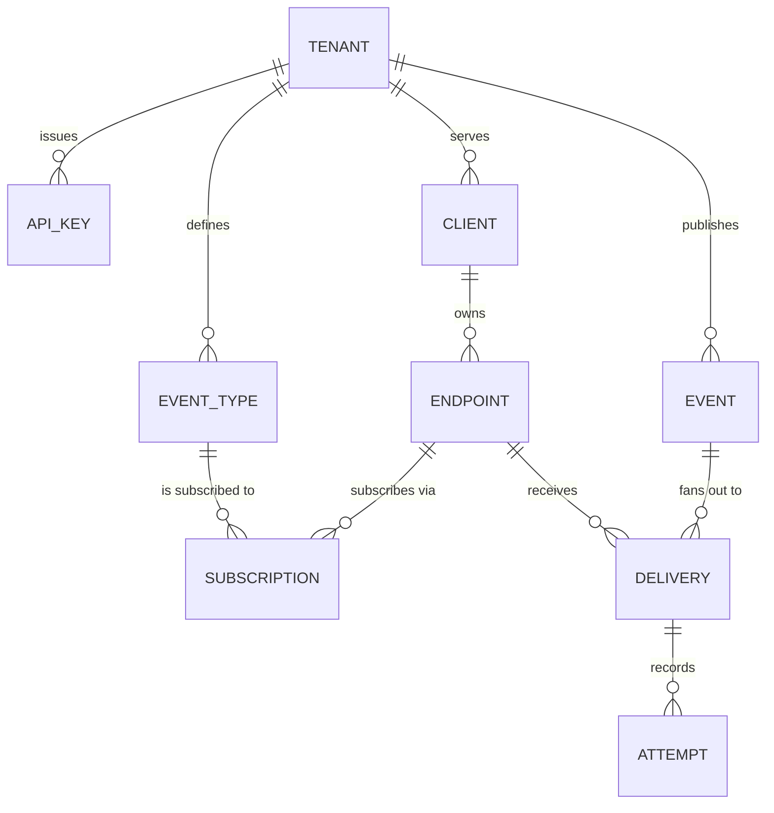

# Webhook Delivery Platform — POC Requirements

| | |
|---|---|
| **Document** | Product & engineering requirements for a proof of concept |
| **Version** | 0.1 (draft for development kickoff) |
| **Status** | Ready to build — open questions in §18 |
| **Audience** | Backend engineers, platform engineer, reviewer of the POC |
| **Source material** | "Webhooks are a product, not a callback" and "Scaling webhooks 10x" (portfolio case studies) |
| **Normative language** | MUST / SHOULD / MAY per RFC 2119 |

---

## 1. Purpose

Build a proof of concept for a **multi-tenant webhook delivery service**. The platform is operated by us; customers sign up as **tenants** and use it to deliver webhooks to **their own clients**, without running delivery infrastructure themselves.

The production system this is modelled on served a single application's partners: one event taxonomy, one set of ~400 receivers, roughly 100K events/day, six always-on workers, at-least-once delivery with three attempts and a hand-inspected dead-letter queue. It worked, and it had three documented gaps that this POC treats as day-one requirements rather than as future work:

1. **No transactional outbox** — events could be lost between the business change and the published event. One release pointed a Celery queue at the wrong Redis queue and two event types silently stopped publishing for a day. Nothing alerted, because every metric described work the system had done, never work it had failed to do.
2. **No per-receiver rate limiting or concurrency cap** — the blast radius on a receiver's infrastructure was unbounded during a burst.
3. **No signed timestamp** — HMAC existed, but with no replay window, so a captured request could be replayed indefinitely.

The POC's job is to demonstrate that the delivery mechanics, the tenant model, and the developer experience are right. It is not a production hardening exercise; §15 defines what is deliberately excluded.

### 1.1 What this POC is proving

| # | Proposition | How the POC proves it |
|---|---|---|
| P1 | A tenant can integrate and receive a verifiable webhook in under 15 minutes, without engineering help from us | Timed walkthrough of the onboarding flow |
| P2 | Delivery is at-least-once and every attempt is inspectable by both sides | Attempt trail visible in UI and API |
| P3 | An event cannot be lost between "the tenant published it" and "it was queued" | Outbox + relay with lag visible under fault injection |
| P4 | One slow or failing endpoint cannot degrade another tenant's deliveries | Per-endpoint queue and throttle under load test |
| P5 | We can detect the *absence* of expected events, not just failed deliveries | Publication-rate lower-bound alarm firing in a drill |

---

## 2. Actors and terminology

The word "client" is overloaded, so it is fixed here and used consistently throughout.

| Term | Definition |
|---|---|
| **Operator** | Us. Runs the platform, owns infrastructure, on-call, and the admin console. |
| **Tenant** (a.k.a. *source user*, *source*) | A customer of the platform that produces events through our API. A tenant is the isolation and billing boundary. |
| **Client** | A tenant's own customer — the party that owns the receiving endpoint. A tenant may have many clients; a client may have many endpoints. Purely a grouping and permission boundary in the POC. |
| **Endpoint** | A destination URL plus its configuration (secret, headers, event-type subscriptions, retry policy). The unit of delivery. |
| **Event type** | A named contract, e.g. `payment.succeeded`, with a JSON Schema and a payload version. Tenant-scoped. |
| **Event** | One occurrence published by a tenant, carrying an envelope and a payload. |
| **Delivery** | The intent to send one event to one endpoint. Created at fan-out time, durable, independently tracked. |
| **Attempt** | One HTTP request made in service of a delivery. |
| **Publish** | The tenant's act of submitting an event. Distinct from **delivery**, which is our act. |

### 2.1 Role matrix

| Capability | Operator | Tenant owner | Tenant developer | Client user |
|---|---|---|---|---|
| Create/suspend tenants | MUST | — | — | — |
| Issue/revoke API keys | MAY | MUST | SHOULD | — |
| Publish events | — | MUST | MUST | — |
| Manage endpoints | — | MUST | MUST | — |
| Manage event types | — | MUST | SHOULD | — |
| View deliveries for own client | MAY | MUST | MUST | MUST |
| Trigger replay | MAY | MUST | SHOULD | SHOULD |
| View all tenants | MUST | — | — | — |

---

## 3. Goals and non-goals

### 3.1 Goals

- **G-1** Multi-tenant from the first commit: every row, key, and query is tenant-scoped.
- **G-2** At-least-once delivery with an explicit, documented guarantee and a two-key idempotency story.
- **G-3** Durable publish path — an accepted event is never lost.
- **G-4** Per-endpoint isolation of load, retries, and failure.
- **G-5** Complete attempt-level evidence trail readable by the tenant and their client.
- **G-6** Self-service: subscribe, inspect, replay without a support ticket.
- **G-7** Observable absence, not just observable failure.

### 3.2 Non-goals for the POC

- Billing and invoicing (event metering exists; pricing does not).
- Exactly-once delivery (see §9.1 — impossible and not promised).
- Ordering guarantees across events.
- Multi-region, disaster recovery, or a formal SLA.
- A polished client-facing portal (a functional one is sufficient).
- Inbound webhooks (we are the sender, not the receiver).
- Custom domains or white-labelling.

---

## 4. Domain model



**Invariants**

- **I-1** Every entity except `TENANT` carries `tenant_id`; every query filters on it. No cross-tenant read path exists, including admin read paths (admin queries are explicitly scoped and audited).
- **I-2** A `DELIVERY` row is created **before** the first attempt and never deleted. It is the durable record that this event was owed to this endpoint.
- **I-3** A `DELIVERY` is terminal only in states `delivered`, `failed_terminal`, or `cancelled`. Everything else is in flight and must be visible as such.
- **I-4** An `ENDPOINT` belongs to exactly one `CLIENT`, which belongs to exactly one `TENANT`.
- **I-5** `EVENT_TYPE` names are unique per tenant, not globally — two tenants may both define `order.created` with different schemas.

---

## 5. Functional requirements

Priorities: **P0** = POC cannot ship without it · **P1** = needed to demo credibly · **P2** = nice to have, cut first.

### 5.1 Tenant onboarding and identity (FR-1)

| ID | Requirement | Pri |
|---|---|---|
| FR-101 | A visitor MUST be able to self-register a tenant with an email and organisation name, receiving a verification email. | P0 |
| FR-102 | Registration MUST create the tenant, a default `Owner` user, a **test-mode** API key, and a **live-mode** API key, and MUST NOT create any endpoints. | P0 |
| FR-103 | The system MUST support two environments per tenant — `test` and `live` — with fully separated data: test events never reach live endpoints and vice versa. | P0 |
| FR-104 | A tenant MUST be able to invite additional users with role `developer` or `owner`. Roles are enumerated in §2.1. | P1 |
| FR-105 | An operator MUST be able to suspend a tenant; suspension MUST stop event ingestion and non-terminal deliveries, and MUST be reversible. | P1 |
| FR-106 | All tenant-scoped resources MUST be reachable only through a credential belonging to that tenant, or an operator credential recorded in the audit log. | P0 |

### 5.2 API keys and authentication (FR-2)

| ID | Requirement | Pri |
|---|---|---|
| FR-201 | Tenants MUST authenticate to the platform API with a bearer API key. | P0 |
| FR-202 | Keys MUST be shown exactly once at creation and stored only as a hash; the UI MUST NOT be able to redisplay a key. | P0 |
| FR-203 | A key MUST be scoped to one environment (`test` or `live`) and one tenant. | P0 |
| FR-204 | A tenant MUST be able to hold multiple concurrently valid keys, so rotation does not require downtime. | P1 |
| FR-205 | Revocation MUST take effect within 60 seconds across all API instances. | P0 |
| FR-206 | Each key MUST carry a `last_used_at` timestamp surfaced in the UI, so an unused key can be identified and revoked. | P1 |
| FR-207 | Keys MUST be rate-limited per key and per tenant; exceeding the limit returns `429` with `Retry-After`. | P0 |

### 5.3 Event types and schemas (FR-3)

| ID | Requirement | Pri |
|---|---|---|
| FR-301 | A tenant MUST be able to define an event type with a name (`<resource>.<action>`) and a JSON Schema for its payload. | P0 |
| FR-302 | The name MUST match `^[a-z][a-z0-9_]*\.[a-z][a-z0-9_]*$` and be immutable after creation. | P0 |
| FR-303 | Publishing an event of a type whose payload violates its schema MUST be rejected synchronously with a `422` naming the failing JSON pointer. | P0 |
| FR-304 | An event type MUST carry a `payload_version`. Publishing to a new version MUST NOT change the shape delivered to endpoints still subscribed to the old version. | P1 |
| FR-305 | An event type MUST be disableable, which stops new subscriptions while preserving history and in-flight deliveries. | P1 |
| FR-306 | The system SHOULD provide three example event types on tenant creation (`payment.succeeded`, `order.created`, `shipment.delayed`) so the onboarding walkthrough is possible without the tenant authoring a schema. | P1 |

### 5.4 Endpoints (FR-4)

| ID | Requirement | Pri |
|---|---|---|
| FR-401 | A tenant MUST be able to register an endpoint with a name, URL, owning client, and subscribed event types. | P0 |
| FR-402 | Endpoint URLs MUST be `https` in live mode. `http` MUST be accepted only in test mode, and MUST be rejected for private/loopback/link-local address ranges in both environments unless the endpoint is explicitly marked `internal`. | P0 |
| FR-403 | The platform MUST verify endpoint ownership before enabling live delivery: the endpoint MUST answer a verification challenge (`200` with a token echoed) within 10 seconds. An unverified endpoint MUST NOT receive live events. | P0 |
| FR-404 | Each endpoint MUST have its own signing secret, generated by the platform, rotatable, and shown to the tenant. | P0 |
| FR-405 | A tenant MUST be able to set up to 5 custom headers (key + value) attached to every request to that endpoint. Header names matching `^(Host|Content-Length|Content-Type|Authorization)$` MUST be rejected. | P1 |
| FR-406 | An endpoint MUST have a configurable description free-text field (≤ 2000 chars) for the tenant's own notes. | P2 |
| FR-407 | An endpoint MUST be pausable; a paused endpoint accumulates no new deliveries and any in-flight deliveries are held, not failed. | P0 |
| FR-408 | Deleting an endpoint MUST retain its delivery history for the retention window (§11.7) and MUST NOT orphan deliveries. | P0 |

### 5.5 Subscriptions (FR-5)

| ID | Requirement | Pri |
|---|---|---|
| FR-501 | A subscription is the `(endpoint, event_type)` pair and MUST be creatable and deletable independently. | P0 |
| FR-502 | Fan-out MUST resolve an event to all **active** subscriptions whose endpoint is active and whose event type matches exactly. | P0 |
| FR-503 | An event with zero matching subscriptions MUST be recorded as `no_subscribers` and MUST NOT create deliveries or retries. | P0 |
| FR-504 | A subscription MUST support a per-subscription filter expression (P2, simple equality on top-level payload fields only) so a tenant can send `payment.succeeded` to an endpoint only when `payload.currency == "INR"`. | P2 |

### 5.6 Event ingestion (FR-6)

| ID | Requirement | Pri |
|---|---|---|
| FR-601 | A tenant MUST be able to publish a single event via `POST /v1/events` and receive `202 Accepted` with an `event_id`. | P0 |
| FR-602 | A tenant MUST be able to publish up to 500 events in one `POST /v1/events/batch` call, with per-item results. | P1 |
| FR-603 | A publish call MUST be idempotent on a caller-supplied `idempotency_key` for 24 hours; a replay MUST return the original `event_id` and MUST NOT create a second event. | P0 |
| FR-604 | The publish path MUST write the event and its **outbox record in the same database transaction** (`SEC-1` in §12); a `202` MUST NOT be returned if the outbox write fails. | P0 |
| FR-605 | A tenant SHOULD be able to override the event timestamp with `occurred_at`, bounded to `[now - 7d, now + 5m]`. | P1 |
| FR-606 | Publish MUST reject payloads over 64 KB with `413`, and events over the tenant's quota with `429`. | P0 |
| FR-607 | The publish API MUST sustain 200 req/s per tenant in the POC load test (§17.3), with p99 latency ≤ 250 ms excluding network. | P1 |

#### 5.6.1 Publish request

```http
POST /v1/events
Authorization: Bearer whsec_test_...
Idempotency-Key: 8f2c1a9e-...
Content-Type: application/json

{
  "event_type": "payment.succeeded",
  "client_ref": "client_7Hq2",          // optional; used for filtering and reporting
  "occurred_at": "2026-10-26T09:14:02Z", // optional
  "data": { "payment_id": "pay_123", "amount": 49900, "currency": "INR" }
}
```

Response `202`:

```json
{ "event_id": "evt_01J9Z...", "status": "accepted", "deliveries_created": 3 }
```

Note `deliveries_created` is a *best-effort* count at fan-out time; §9.2 explains why the API does not report delivery success synchronously.

### 5.7 Fan-out (FR-7)

| ID | Requirement | Pri |
|---|---|---|
| FR-701 | A relay MUST read unpublished outbox rows and publish each event to the internal bus, marking the row published only after the broker acknowledges. | P0 |
| FR-702 | Outbox rows MUST be processed in `created_at` order per tenant; global ordering MUST NOT be required. | P1 |
| FR-703 | The relay MUST be horizontally scalable by claiming rows with a lease (`SELECT … FOR UPDATE SKIP LOCKED` or equivalent) so two relay instances never publish the same row twice. | P0 |
| FR-704 | Fan-out MUST create one `DELIVERY` per matching subscription **before** any attempt is made, in a single transaction per event. | P0 |
| FR-705 | Fan-out MUST be idempotent on `event_id`: re-processing the same event MUST NOT create duplicate deliveries (a unique constraint on `(event_id, endpoint_id)` enforces this). | P0 |
| FR-706 | Fan-out MUST route priority-class events and normal-class events onto separate queues with separate worker pools, so a slow bulk stream cannot delay a user-blocking event. | P0 |

### 5.8 Delivery (FR-8)

| ID | Requirement | Pri |
|---|---|---|
| FR-801 | Delivery MUST POST the signed envelope to the endpoint URL with the tenant's custom headers and a `Content-Type: application/json`. | P0 |
| FR-802 | Each attempt MUST have a hard timeout of **15 seconds**, configurable per endpoint within `[5s, 30s]`. | P0 |
| FR-803 | A delivery MUST be marked `delivered` only on a `2xx` response. `3xx` MUST NOT be followed. | P0 |
| FR-804 | Response status code and the first 2 KB of response body MUST be persisted per attempt. | P0 |
| FR-805 | Delivery MUST be retried per §8 on any non-`2xx`, timeout, connection error, or DNS failure. | P0 |
| FR-806 | Deliveries to one endpoint MUST be concurrency-capped (§12 `SEC-3`) so a burst cannot open unbounded parallel connections to a client. | P0 |
| FR-807 | A delivery whose endpoint is paused MUST be held in `pending` and MUST NOT consume retry budget. | P0 |
| FR-808 | The worker MUST NOT follow redirects, MUST NOT send cookies, and MUST NOT reuse a connection across endpoints. | P0 |

### 5.9 Idempotency and dedupe (FR-9)

| ID | Requirement | Pri |
|---|---|---|
| FR-901 | Every event MUST carry a globally unique `event_id` (ULID or UUIDv7) minted at publish time. | P0 |
| FR-902 | The envelope MUST include a `delivery_id` distinct from `event_id`, so a client can distinguish "same event, second attempt" from "different event". | P1 |
| FR-903 | The platform SHOULD store a per-`(endpoint, event_id)` dedupe key with a 30-day TTL and MUST expose it in the attempt trail so support can answer "was this a duplicate?" | P1 |
| FR-904 | The documentation MUST state, verbatim in the integration guide, that the client is responsible for idempotent handling and name both keys. | P0 |

### 5.10 Security and signing (FR-10)

| ID | Requirement | Pri |
|---|---|---|
| FR-1001 | Every request MUST carry a signature header: `X-Webhook-Signature: t=<unix>,v1=<hex>` where `v1 = HMAC-SHA256(secret, "<t>.<raw_body>")`. | P0 |
| FR-1002 | The signature MUST cover the timestamp, so it cannot be replayed after the tolerance window. | P0 |
| FR-1003 | Consumers MUST reject requests whose `t` is more than **300 seconds** away from their clock; this tolerance MUST be documented and configurable within `[60s, 600s]`. | P0 |
| FR-1004 | Secrets MUST be rotatable with an overlap window: two valid secrets accepted simultaneously for up to 24 hours. | P1 |
| FR-1005 | The platform MUST verify endpoint URLs against SSRF (no `169.254.0.0/16`, no RFC1918, no metadata endpoints) at registration, at verification, and at request time. | P0 |
| FR-1006 | Custom header values MUST be stored encrypted at rest and MUST be redactable from the UI on demand. | P1 |
| FR-1007 | A tenant MUST be able to see the platform's egress IP ranges for allowlisting, via `GET /v1/meta/egress-ips`. | P1 |
| FR-1008 | Secrets MUST NEVER appear in logs, attempt records, or API responses after creation. | P0 |

### 5.11 Attempt trail and inspection (FR-11)

| ID | Requirement | Pri |
|---|---|---|
| FR-1101 | The tenant MUST be able to list deliveries filtered by endpoint, event type, status, and time range, paginated by cursor. | P0 |
| FR-1102 | The tenant MUST be able to fetch one delivery with its full ordered attempt list. | P0 |
| FR-1103 | Each attempt MUST expose: attempt number, timestamp, duration, response status, truncated response body, error class, and next scheduled retry. | P0 |
| FR-1104 | Attempt records MUST be retained for 30 days, deliveries for 90 days; both configurable per tenant. | P1 |
| FR-1105 | A client user MUST see only deliveries belonging to their own client. | P0 |

### 5.12 Replay (FR-12)

| ID | Requirement | Pri |
|---|---|---|
| FR-1201 | A tenant MUST be able to replay a single delivery, or all deliveries matching a filter, without duplicating the underlying event. | P0 |
| FR-1202 | Replay MUST create new `DELIVERY` rows linked to the original (`replay_of_delivery_id`), never mutate history. | P0 |
| FR-1203 | Replay MUST be bounded: maximum 1,000 deliveries per request and a per-endpoint replay rate of 50/s, mirroring the per-endpoint throttle. | P0 |
| FR-1204 | Replay MUST be idempotent on a request key so a double-click does not double-send. | P1 |
| FR-1205 | The attempt trail MUST distinguish a replayed delivery from an original one. | P0 |

### 5.13 Dead-letter handling and failure policy (FR-13)

| ID | Requirement | Pri |
|---|---|---|
| FR-1301 | A delivery that exhausts its attempts MUST move to `failed_terminal` and be retained for replay indefinitely (POC) or 90 days (configurable). | P0 |
| FR-1302 | Ten consecutive failures for one `(endpoint, event_type)` pair within one hour MUST pause that subscription. | P0 |
| FR-1303 | One hundred failures for one endpoint within one hour MUST pause the endpoint. | P0 |
| FR-1304 | Any pause caused by a threshold MUST email the tenant's configured notification address once per pause event, naming the endpoint, the event type, and the first and last failing response. | P0 |
| FR-1305 | A paused subscription or endpoint MUST be resumable by the tenant in one action, and resume MUST NOT automatically replay (replay is an explicit, separate action). | P0 |
| FR-1306 | The DLQ MUST be listable per endpoint, sortable by failure reason, so triage is not a scan of all failures. | P1 |

### 5.14 Notifications (FR-14)

| ID | Requirement | Pri |
|---|---|---|
| FR-1401 | A tenant MUST configure a notification email per endpoint. | P0 |
| FR-1402 | The platform MUST send a notification when an endpoint is paused by a threshold, when verification fails three times, and when a signing secret is rotated. | P1 |
| FR-1403 | Notifications MUST NOT be sent more than once per hour per endpoint (debounce), so a flapping endpoint does not produce a mail storm. | P1 |

### 5.15 Quotas and fairness (FR-15)

| ID | Requirement | Pri |
|---|---|---|
| FR-1501 | Each tenant MUST have a configurable publish quota (events/day) and delivery quota (attempts/day). | P1 |
| FR-1502 | Each endpoint MUST have a configurable concurrency cap (default 10) and a requests-per-second cap (default 25). | P0 |
| FR-1503 | Retries MUST draw from a separate budget from first attempts, so a failing endpoint cannot starve its own first attempts. | P0 |
| FR-1504 | Sustained throttling MUST be visible to the tenant ("we are holding back deliveries to this endpoint") rather than appearing as unexplained latency. | P1 |
| FR-1505 | Per-tenant isolation MUST hold under load: a load test saturating one tenant MUST NOT raise another tenant's p99 publish latency by more than 20%. | P0 |

---

## 6. Event envelope

Fixed for all tenants and all event types. The envelope is the public contract.

```json
{
  "id": "evt_01J9Z6Q2X8",
  "type": "payment.succeeded",
  "version": "1.0",
  "tenant_id": "tnt_8Kd2",
  "created_at": "2026-10-26T09:14:02.412Z",
  "delivery_id": "dlv_01J9Z6Q4AB",
  "attempt": 1,
  "data": { "payment_id": "pay_123", "amount": 49900, "currency": "INR" }
}
```

| Field | Stability | Notes |
|---|---|---|
| `id` | Immutable per event | Primary dedupe key. ULID so it sorts by time. |
| `type` | Immutable per event type | Namespaced by the tenant's own definition. |
| `version` | Per event type | Payload schema version. Absent version = `1.0`. |
| `tenant_id` | Immutable | Included so a shared endpoint can route without a lookup. |
| `created_at` | Immutable | ISO-8601 UTC with milliseconds. |
| `delivery_id` | Changes per delivery | Distinguishes a retry of the same event from a new event. |
| `attempt` | Changes per attempt | 1-based. |
| `data` | Per schema | Validated against the tenant's JSON Schema before accept. |

**Rules**

- The envelope MUST be stable; adding a top-level field is a `version` bump for the *event type*, not the envelope.
- `data` MUST be an object, never a bare array or scalar.
- The raw body sent is the serialised envelope; the signature covers exactly those bytes (§5.10).

---

## 7. API surface (POC)

All paths are `/v1`, all require a bearer key, all are tenant-scoped.

| Method | Path | Purpose | Pri |
|---|---|---|---|
| POST | `/events` | Publish one event | P0 |
| POST | `/events/batch` | Publish up to 500 | P1 |
| GET | `/events/{id}` | Event + its deliveries | P0 |
| POST | `/event-types` | Create event type + schema | P0 |
| GET | `/event-types` | List | P0 |
| PATCH | `/event-types/{name}` | Version, disable | P1 |
| POST | `/endpoints` | Create endpoint | P0 |
| GET | `/endpoints` | List | P0 |
| GET | `/endpoints/{id}` | Detail + health | P0 |
| PATCH | `/endpoints/{id}` | Pause, resume, headers, secret rotate | P0 |
| DELETE | `/endpoints/{id}` | Soft delete | P0 |
| POST | `/endpoints/{id}/verify` | Trigger ownership challenge | P0 |
| POST | `/endpoints/{id}/test` | Send a synthetic event | P1 |
| PUT | `/endpoints/{id}/subscriptions` | Replace subscription set | P0 |
| GET | `/deliveries` | Cursor-paginated, filterable | P0 |
| GET | `/deliveries/{id}` | Delivery + attempts | P0 |
| POST | `/deliveries/{id}/replay` | Replay one | P0 |
| POST | `/replays` | Replay by filter | P1 |
| GET | `/meta/egress-ips` | Allowlist ranges | P1 |
| GET | `/health` | Liveness (unauthenticated) | P0 |

**Conventions**

- Errors: `{ "error": { "code": "...", "message": "...", "details": [...] } }`, never a bare string.
- Pagination: `?cursor=&limit=` with `has_more` and `next_cursor`.
- All timestamps ISO-8601 UTC.
- `Idempotency-Key` honoured on all `POST` mutation endpoints.
- Every response carries `X-Request-Id`; the same id appears in logs and is shown in the UI so a support conversation can start from it.

---

## 8. Retry policy

| Parameter | Default | Configurable per endpoint |
|---|---|---|
| Max attempts | 3 | 1–10 |
| Backoff | Exponential, base 30s, factor 4, ±20% jitter → ~30s, ~2m, ~8m | base and factor only |
| Timeout per attempt | 15s | 5–30s |
| Total window | ~10 minutes | — |
| Retriable | timeouts, connection errors, `408`, `425`, `429`, `5xx` | — |
| Non-retriable | `400`, `401`, `403`, `404`, `410`, `422` (moves to terminal immediately) | — |
| Retry-After | If present on `429`/`503` and ≤ 300s, MUST be honoured in place of computed backoff | — |

**Design notes**

- The exponential base is intentionally much shorter than the production system's day-scale backoff, because a POC's failure is usually a configuration error the tenant fixes in minutes, not an overnight outage. Ten attempts over 24 hours remains a P2 option.
- Non-retriable `4xx` MUST fail fast. Retrying a `404` three times is three useless requests to a client's infrastructure and hides the real problem from the tenant.
- Jitter is mandatory; without it a burst of failures retries in lockstep and produces a second spike (§12 `SEC-3`).

---

## 9. Delivery semantics

### 9.1 The guarantee, stated precisely

**Guaranteed:** every event matching an active, enabled subscription is attempted at least once; every attempt is recorded; a delivery completes only on `2xx`.

**Not guaranteed:** exactly-once delivery; ordering between events; a bounded delivery time.

**Required of the client:** idempotent handling, keyed on `id` with `delivery_id` as the discriminator.

This paragraph MUST appear in the integration guide verbatim, because the client's implementation depends on it and a vague promise ("we deliver reliably") is the source of half of all webhook support tickets.

### 9.2 Why publish is asynchronous

`POST /v1/events` returns `202` and never blocks on delivery. A synchronous delivery attempt would make the tenant's publish latency depend on their client's latency — the exact coupling the platform exists to remove. The API reports acceptance, not delivery; delivery state is read from `/deliveries`.

### 9.3 Ordering

Not guaranteed. Two events for the same resource may be delivered in either order, and may be delivered concurrently to different endpoints. The integration guide MUST say so and recommend that clients compare `created_at` rather than assume arrival order.

---

## 10. Multi-tenancy requirements

| ID | Requirement |
|---|---|
| MT-1 | Every table has `tenant_id`; every query filters on it. A shared ORM/query helper MUST make it hard to write an unscoped query (scoped repository / `default_scope`), and a test MUST assert cross-tenant reads fail for every resource. |
| MT-2 | API keys are tenant- and environment-scoped; a key from tenant A MUST return `404` (not `403`) for tenant B's resources, so ids are not enumerable. |
| MT-3 | Queues are partitioned by tenant (shared queue with per-tenant fair scheduling is acceptable for the POC, but a single hot tenant MUST NOT starve others — FR-1505). |
| MT-4 | Rate limits are enforced per tenant and per key, never globally only. |
| MT-5 | Operator access to tenant data MUST be audited with actor, reason, and timestamp. |
| MT-6 | Tenant deletion MUST hard-delete after the retention window and MUST be provable with an export handed to the tenant first. |
| MT-7 | Secrets are encrypted per tenant with a key that does not permit one tenant's ciphertext to be decrypted under another's context. |

---

## 11. Non-functional requirements

Targets are for a **POC on a single region, 3 app instances**. They are deliberately modest; §11.6 notes what changes for production.

| ID | Area | Requirement |
|---|---|---|
| NFR-1 | Publish latency | p99 ≤ 250 ms at 200 req/s/tenant, excluding client network |
| NFR-2 | Delivery latency | Priority: p99 ≤ 5 s publish→first attempt. Normal: p99 ≤ 60 s. |
| NFR-3 | Outbox lag | p99 ≤ 2 s from accept to publish, alarm at 30 s |
| NFR-4 | Throughput | 1,000 events/s sustained across all tenants in the load test; 10 endpoints per event |
| NFR-5 | Availability | 99.5% monthly for the POC; no formal SLA |
| NFR-6 | Durability | Accepted event = ≤ 1 acknowledged write loss only on total storage loss; no loss on process crash |
| NFR-7 | Recovery | Relay resumes automatically after restart with no duplicate deliveries (FR-705) |
| NFR-8 | Idempotent restart | Killing any worker mid-attempt MUST result in either a completed or a retried attempt, never a lost delivery |
| NFR-9 | Retention | Deliveries 90d, attempts 30d, events 90d (configurable) |
| NFR-10 | Payload size | 64 KB max per event |
| NFR-11 | Clock | All servers NTP-synced; signature timestamps use server clock, skew budget ±2 s |

### 11.6 What changes for production

- Multi-AZ, a replicated broker, and a database with point-in-time recovery.
- Per-tenant fair scheduling replaced by dedicated partitions above a volume threshold.
- 99.9%+ with an error budget, and a documented incident process.
- Load shedding (shed new publishes, never in-flight deliveries) under saturation.

### 11.7 Retention defaults

| Data | Default | Rationale |
|---|---|---|
| Deliveries | 90 days | Long enough for a monthly reconciliation dispute |
| Attempts + response bodies | 30 days | Storage cost grows fastest here |
| Events | 90 days | Needed for replay |
| Secrets (old, during rotation) | 24 hours | Overlap window |

---

## 12. Security requirements

| ID | Requirement | Why |
|---|---|---|
| SEC-1 | Outbox row written in the same transaction as the accepted event | Closes the production gap that lost a day of events |
| SEC-2 | HMAC-SHA256 over `"<timestamp>.<body>"`, 300 s tolerance | Prevents forgery and replay; the production system had no replay window |
| SEC-3 | Per-endpoint concurrency + RPS caps, retries in a separate budget | Prevents us becoming the client's outage |
| SEC-4 | SSRF protection at register, verify, and request time | Tenants are untrusted; a URL is attacker-controlled input |
| SEC-5 | Secrets hashed (API keys) or encrypted (signing secrets), never logged | — |
| SEC-6 | TLS 1.2+ only, HSTS on the portal | — |
| SEC-7 | Audit log for key creation/revocation, secret rotation, replay, operator access | — |
| SEC-8 | Tenant data isolation tested by an automated cross-tenant access suite | — |
| SEC-9 | No secret or full response body in logs; bodies truncated at 2 KB and redacted by pattern | — |

---

## 13. Observability requirements

The production system measured only the work it had done. Every metric below that is marked **[absence]** exists specifically to catch work that *should* have happened and didn't.

| ID | Metric | Type | Alarm |
|---|---|---|---|
| OBS-1 | `events_accepted_total` per tenant/type | counter | — |
| OBS-2 | `outbox_unpublished_age_seconds` | gauge | > 30s for 2 min |
| OBS-3 | `publication_rate` per event type vs expected baseline **[absence]** | counter + baseline | < 20% of trailing-hour baseline for 10 min |
| OBS-4 | `deliveries_created_total` | counter | — |
| OBS-5 | `delivery_attempt_duration` p50/p95/p99 | histogram | — |
| OBS-6 | `delivery_success_rate` per endpoint | gauge | < 90% over 15 min |
| OBS-7 | `delivery_latency_publish_to_first_attempt` p99 | histogram | priority > 5s |
| OBS-8 | `dlq_depth` per endpoint | gauge | > 50 |
| OBS-9 | `queue_lag_seconds` per queue | gauge | > 300s |
| OBS-10 | `endpoints_paused_total` | counter | any increase notifies tenant |
| OBS-11 | `replay_requests_total` | counter | — |
| OBS-12 | Publish API 5xx rate | counter | > 0.5% |

**OBS-3 deserves emphasis.** It is the requirement that the production incident proved necessary. The baseline is per event type, computed over a trailing window, with a lower bound; a drop to near-zero while the tenant still holds an active integration is an alert, not a dashboard. Implementation may be a simple hourly comparison for the POC, but the requirement is that **some** signal exists for expected-but-absent events.

**Tracing:** every accept → outbox → publish → fan-out → attempt chain carries one trace id derived from `event_id`, so a single event's full path is one query.

---

## 14. Portal requirements

A functional portal is P1; the API is the primary surface. The portal exists to prove P1 in §1.1 (15-minute integration without us).

| ID | Requirement | Pri |
|---|---|---|
| UI-1 | Onboarding checklist: create tenant → define event type → add endpoint → verify → send test event → see delivery. Progress persisted. | P1 |
| UI-2 | Endpoint list with health (last success, failure streak, paused state). | P1 |
| UI-3 | Delivery list with filters and a detail view showing every attempt and its response body. | P1 |
| UI-4 | One-click "send test event" per endpoint, clearly marked as synthetic and non-durable. | P1 |
| UI-5 | Replay control with an explicit confirmation stating how many deliveries and the rate. | P1 |
| UI-6 | Secret rotation with the overlap window explained in the UI. | P1 |
| UI-7 | Copy-pasteable code snippets (curl, Node, Python) for signature verification. | P1 |
| UI-8 | Client-scoped login that shows only that client's deliveries. | P1 |
| UI-9 | Integration guide page rendering the live event-type schemas. | P1 |

---

## 15. Explicitly out of scope

- Billing, invoicing, plans, and payment collection.
- Inbound webhook ingestion.
- Custom domains, white-labelling, per-tenant branding.
- Ordering guarantees.
- Multi-region and cross-region failover.
- Mobile clients.
- A schema registry with breaking-change detection (a version field is enough for the POC).
- Kafka. The POC uses a managed queue/broker; the outbox + relay pattern is the requirement, the transport is substitutable.

---

## 16. Acceptance criteria

Each criterion is a test that must pass before the POC is called done.

| ID | Scenario | Expected |
|---|---|---|
| AC-01 | New tenant registers and completes onboarding | A verified endpoint receives a real event; total elapsed ≤ 15 min by a first-time user |
| AC-02 | Publish an event with 3 matching subscriptions | 3 deliveries created, each with its own attempt trail |
| AC-03 | Publish an event with no matching subscription | Status `no_subscribers`, zero deliveries, zero retries |
| AC-04 | Endpoint returns `500` twice then `200` | 3 attempts recorded, delivery `delivered`, backoff visible between attempts |
| AC-05 | Endpoint returns `404` | Terminal after one attempt (non-retriable), replay offered |
| AC-06 | Endpoint hangs for 20s | Attempt times out at 15s, recorded as timeout, retried |
| AC-07 | Kill a worker mid-attempt | Delivery is retried; no duplicate attempt number, no lost delivery |
| AC-08 | Kill the relay after accept, before publish | Event is published on restart; exactly one delivery set created (FR-705) |
| AC-09 | Stop the relay for 10 minutes | OBS-2 alarms; publish still returns `202`; no events lost |
| AC-10 | Client verifies the signature | Valid signature passes; tampered body fails; timestamp older than 300s fails |
| AC-11 | Replay the same delivery twice with the same request key | Second request returns the first result; one set of new deliveries |
| AC-12 | Replay 5,000 deliveries by filter | Rejected with a bound error naming the limit (FR-1203) |
| AC-13 | Endpoint with 10 failures in an hour | Subscription paused; one email sent; resume works |
| AC-14 | Tenant A requests tenant B's delivery id | `404`, and the attempt is logged as a cross-tenant probe |
| AC-15 | Load test: one tenant at 200 req/s, another idle | Idle tenant's publish p99 degrades ≤ 20% |
| AC-16 | Burst 5,000 events to one endpoint | Endpoint receives ≤ its concurrency cap concurrently; no other endpoint's delivery latency degrades beyond NFR-2 |
| AC-17 | Disable publication for one event type | OBS-3 fires within 10 minutes |
| AC-18 | Rotate a secret with overlap | Both old and new signatures validate during the overlap; only the new one after |
| AC-19 | Endpoint URL `http://169.254.169.254/latest/meta-data` | Rejected at registration with a clear error |
| AC-20 | Cross-tenant suite over every resource | All return `404`; suite is part of CI |

---

## 17. Delivery plan

### 17.1 Milestones

| Milestone | Scope | Exit criterion |
|---|---|---|
| **M0 — Skeleton** (2–3 d) | Tenants, API keys, DB schema, `/health`, CI, cross-tenant test harness | A key authenticates and MT-1 tests pass |
| **M1 — Ingest + deliver** (4–5 days) | Event types, endpoints, subscriptions, publish, outbox + relay, fan-out, one queue, basic delivery | AC-02, AC-08, AC-10 pass |
| **M2 — Reliability** (3–4 days) | Retry/backoff, non-retriable classification, attempt trail, DLQ, pause thresholds, per-endpoint throttle | AC-04 … AC-07, AC-13, AC-16 pass |
| **M1/P1 — Portal** (3–4 days, parallel) | Onboarding checklist, endpoint + delivery views, test event | AC-01 passes |
| **M3 — Inspection and replay** (2–3 d) | Replay with bounds, dedupe visibility, filters, cursors | AC-11, AC-12 pass |
| **M4 — Observability** (2 d) | OBS-1 … OBS-12, tracing, absence alarm | AC-09, AC-17 pass |
| **M5 — Hardening** (2–3 d) | SSRF tests, secret rotation, quotas, load test | AC-14, AC-15, AC-18 … AC-20 pass |

Total: roughly 4–5 weeks for one engineer, with the portal parallelisable.

### 17.2 Build order, and why

The outbox and the per-endpoint throttle are **M1**, not later. They are the two things that are expensive to retrofit — the outbox because it changes the publish transaction, and the throttle because it changes the queue shape. Every other requirement can be added behind an interface; those two cannot.

### 17.3 Load test

Sustained 1,000 events/s for 10 minutes with 10 subscriptions each, tenants distributed unevenly (one tenant at 50%), one endpoint deliberately hanging at 15s, one returning `500`. Pass criteria: NFR-1 … NFR-4, AC-15, AC-16, and no unbounded queue growth.

---

## 18. Open questions

| # | Question | Owner | Impact if unresolved |
|---|---|---|---|
| Q1 | Do tenants need per-client routing of the *same* event type to different endpoints with different payload projections, or is fan-out-to-all-subscribers sufficient? | Product | Changes fan-out from a fan-out to a transform pipeline |
| Q2 | Should the POC use one shared broker topic per tenant or a shared queue with fair scheduling? | Eng | Affects MT-3 cost model |
| Q3 | Is a filtered subscription (FR-504) a POC requirement or P2? It changes the subscription schema. | Product | Schema migration if added later |
| Q4 | Does the portal need SSO, or is email + password sufficient for a POC? | Product | 2–3 days either way |
| Q5 | Is a 15-minute onboarding target measurable with a real external user, or only with a scripted walkthrough? | Product | Determines whether P1 is proven or asserted |

---

## 19. Suggested stack (non-binding)

The requirements are transport-agnostic; this is a starting point that satisfies §17.2 with the least operational surface.

| Concern | Suggestion | Note |
|---|---|---|
| App | Python (FastAPI) or Node (Fastify) | Fastest to the publish fan-out with good JSON ergonomics |
| DB | PostgreSQL | `SKIP LOCKED` for the relay; JSONB for payloads; one transaction for event + outbox |
| Broker | SQS / RabbitMQ / Redis Streams | SQS per-endpoint queues give the throttle and DLQ almost free |
| Workers | Long-lived consumers | Simpler than serverless for a POC; serverless is the 10x path, not the POC path |
| Cache/dedupe | Redis | `(endpoint, event_id)` keys with TTL |
| Portal | Server-rendered or a thin SPA | Do not build a design system for a POC |
| Observability | OpenTelemetry → Prometheus + Grafana | OBS-3 needs a queryable counter with a baseline |

**A note on choosing workers over serverless:** the 10x article argues for serverless fan-out and delivery, and that is right at 1M events/day with spiky load. At POC volume a fixed worker pool is cheaper, easier to debug, and has no cold-start problem on the priority path. The requirement here is the *shape* — outbox, per-endpoint queues, separate retry budget — not the runtime.

---

## Appendix A — Requirement traceability

Every requirement that exists because the production system lacked it.

| Production lesson | Requirement |
|---|---|
| Event lost between business change and publish; no record of what was owed | FR-604, FR-701, SEC-1, AC-08 |
| No alert for events that should have existed | OBS-3, AC-17 |
| No per-partner concurrency cap; blast radius unbounded | FR-806, FR-1502, FR-1503, SEC-3, AC-16 |
| HMAC with no timestamp; replay possible forever | FR-1001 … FR-1003, AC-10 |
| Retry on `4xx` wasted three calls and hid the real error | FR-805 classification, AC-05 |
| No visibility into why a delivery failed | FR-804, FR-1103, UI-3 |
| Replay was a manual reconstruction by whoever knew the system | FR-1201 … FR-1205, AC-11 |
| One event taxonomy hardcoded to one product | FR-301, I-5, FR-304 |
| Portal was internal; partners needed a ticket | UI-1 … UI-9, FR-101 |
| Fan-out and delivery on a shared pool with no tenant isolation | FR-706, MT-3, FR-1505 |
